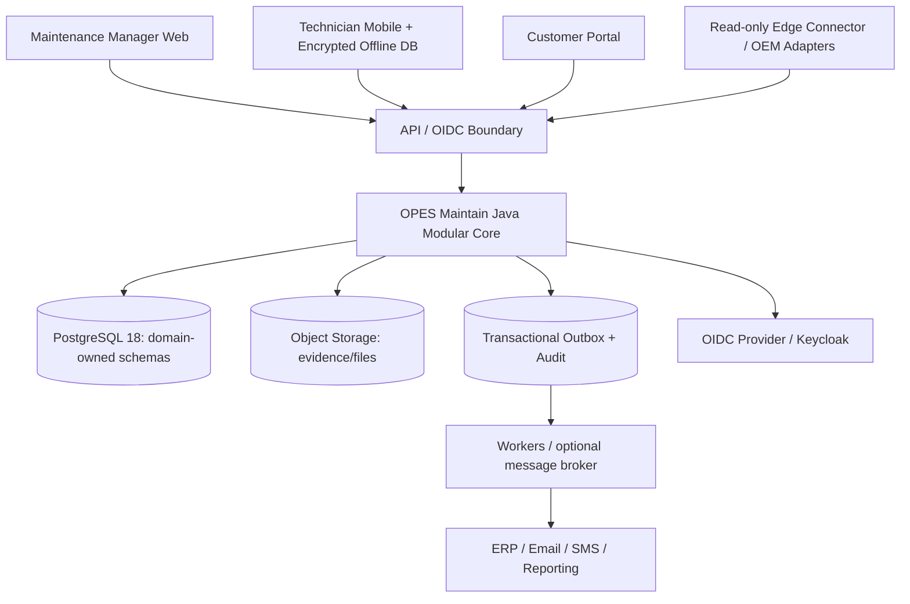
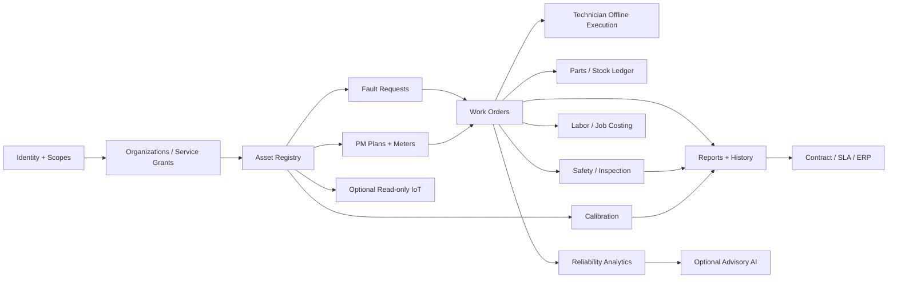

# OPES Maintain — Complete Product Specification and Reference Architecture

> **Document authority:** This is the proposed single-source-of-truth **design baseline** for OPES Maintain. It specifies intended behavior, constraints, architecture, contracts, validation and delivery gates. It is **not** a claim that the software is built, bug-free, certified, secure in deployment, or approved under any standard. Those outcomes require implementation evidence, independent testing, operational controls, customer acceptance and any applicable regulatory review.
>
> **Scope boundary:** OPES Maintain manages the life cycle, reliability, inspection, maintenance and servicing of assets. It is **not** the OPES Life Sciences pharmaceutical batch-genealogy database, not EMRSQL, not a replacement for ERP general ledgers, and not a PLC/SCADA industrial controller. Integrations are governed explicitly in §§13, 17 and Appendix D.

## Document control and reading convention

| Field | Rule |
|---|---|
| Normative keywords | **MUST** mandatory; **SHOULD** preferred unless a documented ADR records an exception; **MAY** optional. |
| Requirement IDs | `OM-<DOMAIN>-<NNN>`; IDs are immutable once referenced by tests. |
| Status | `PROPOSED` until approved via architecture-review record. |
| Priority | `P0` = required for first commercially usable release; `P1` = enterprise expansion; `P2` = advanced/conditional. |
| Source of truth | This file for design intent; executed migrations, OpenAPI, CI, operational runbooks and release evidence for implementation truth. |
| Change control | Semantic version this document; record material changes in an ADR and changelog. |
| Currency and locale | FCFA (XAF) for Cameroon; configurable currency, language and tax rules by customer/jurisdiction. |
| Clocks | Persist UTC timestamps; show site time zone; never infer time zone from a device. |
| Authentication | Human identity from OIDC; business authorization remains server-side. |

### Contents
1. Vision, users, product boundaries and outcomes
2. Decisions, principles and technology stack
3. Context and deployment architecture
4. Bounded contexts and dependency constraints
5. Functional specification of 28 modules
6. Canonical operational workflows and state machines
7. Reference data model and persistence rules
8. API specification and error model
9. Domain events, outbox and integration contracts
10. Offline-first technician sync protocol
11. Identity, permissions, tenant isolation and privacy
12. Audit, documents, evidence and records lifecycle
13. Reliability, scheduling, financial and reliability mathematics
14. UX, screen inventory and accessibility
15. Performance, resilience, observability and operations
16. Security engineering and threat controls
17. Integration and extensibility architecture
18. Standards, legal obligations and compliance scope
19. Test strategy and acceptance suite
20. CI/CD, environments, migrations and go-live gates
21. Phases, milestones, dependencies and ownership
22. Risks, assumptions and decision register
23. Definition of done and change-control policy
24. Source references and appendices

---

# 1. Vision, users, product boundaries and outcomes

## 1.1 Mission

OPES Maintain is an industrial maintenance operating system for (a) maintenance service contractors managing several clients' equipment, (b) small and medium industrial plants and (c) asset-intensive enterprises. It digitizes the complete cycle from equipment registration and breakdown reporting to preventive scheduling, technician execution, parts consumption, approvals, invoicing integration, reliability reporting and asset lifecycle evidence.

**Initial buyer:** Maintenance company owner/operations director, factory maintenance manager or technical director. **Initial geography:** Cameroon. **Initial UI languages:** French and English. **Initial deployment:** SaaS and dedicated on-prem; hybrid integration later.

## 1.2 Personas and responsibility

| Persona | Business objective | Typical rights (subject to scope) |
|---|---|---|
| Tenant owner / platform customer administrator | Manage the contracted organization | Configure sites, policies, memberships; view tenant billing. |
| Maintenance manager | Maximize uptime, cost control and compliance | Plan, prioritize, assign, review, approve within delegation. |
| Planner / dispatcher | Schedule resources and materials | Build maintenance schedules; dispatch authorized work. |
| Technician / field engineer | Execute safe, documented maintenance | See assigned jobs, record findings, time, parts and evidence; request completion. |
| Inventory controller | Secure spare-parts movements | Receive, reserve, issue, return, count and reconcile stock. |
| Safety officer | Ensure required safeguards | Review hazards, isolation and permit evidence before work. |
| Quality / calibration officer | Govern inspection and measurement accuracy | Review calibration records, findings and certificates. |
| Client organization representative | Monitor contractor's work on client assets | Create requests; inspect own assets and approved service records. |
| Finance / contract officer | Manage commercial fulfillment | Maintain rates, contracts, quotations, approved billable items. |
| Executive / analyst | Monitor reliability and service profitability | Access authorized site-aggregate metrics and exports. |
| Integration service account | Exchange controlled data | Narrow, non-human API scopes; no interactive privileges. |
| Platform operator | Maintain service reliability | Infra-only access; customer business data access via time-boxed, audited break-glass. |

## 1.3 Essential product outcomes

- `OM-PRD-001 [P0]` Register any customer-owned or tenant-owned asset under an explicit ownership and service agreement.
- `OM-PRD-002 [P0]` Generate, assign, execute and close corrective and preventive work orders with complete attribution.
- `OM-PRD-003 [P0]` Support technician work in low-connectivity environments without silently bypassing approvals.
- `OM-PRD-004 [P0]` Reserve and issue spare parts exactly once, with auditable stock movement and job costing.
- `OM-PRD-005 [P0]` Attribute labor, materials, subcontractor charges and downtime to equipment and service jobs.
- `OM-PRD-006 [P0]` Enforce organization/site/client authorization at both query and command boundaries.
- `OM-PRD-007 [P0]` Produce a defensible maintenance history, service report and management dashboard.
- `OM-PRD-008 [P1]` Handle multi-site and multi-customer SLA, calibration, compliance and contract workflows.
- `OM-PRD-009 [P2]` Add telemetry-based maintenance and AI only after reliable baseline history exists.

## 1.4 Explicit non-goals

- Running a general ledger, tax engine, payroll or full enterprise ERP; use audited integrations.
- Issuing statutory inspection licenses or automatically certifying ISO compliance.
- Remotely controlling pumps, motors, production lines, medical devices or safety interlocks.
- Treating mobile-recorded signatures as automatically equivalent to legally regulated digital signatures.
- Building a separate database engine, universal industrial IoT cloud or compulsory blockchain.
- Accepting autonomous AI instructions to release safety-critical work, reset alarms or close incidents.
- Treating contractor access to a client's asset as ownership of the client's operational records.

## 1.5 Success measures (pilot; to be calibrated)

Measure customer-reported unplanned downtime, PM completion rate, mean response time, work-order closure lead time, first-time fix, stock discrepancies, expired calibration rate, overdue work orders, technician documentation compliance, SLA breaches, and service contract gross margin. Establish customer-specific baseline **before** claiming improvement. Track adoption separately from operational impact; no fabricated ROI percentages.

---

# 2. Decisions, principles and technology stack

## 2.1 Architecture decision summary

| Decision | Binding direction | Rationale / caveat |
|---|---|---|
| System structure | **Modular monolith**, with exceptional edge adapters | Low operational overhead and strong transactional core. |
| Domain design | **DDD bounded contexts + hexagonal ports/adapters** | Independent invariants; testable business rules. |
| Integration | **Versioned REST APIs + transactional outbox + idempotent consumers** | Safe cross-module and external integration. |
| Query design | Conventional relational access; **selective CQRS** for analytics | Avoid duplicated read models prematurely. |
| Event storage | Operational PostgreSQL and append-only audit/evidence; **not universal event sourcing** | Reconstructable decisions without needless complexity. |
| Data tenancy | Mandatory `tenant_id` + scoped authorization; optional dedicated DB | Explicit actor-client-asset relationship checks. |
| Mobile | Offline-capable constrained sync; server-authoritative commands | Field usability without offline privilege escalation. |
| Industrial integration | Read-only ingestion first; isolated site connector | No remote control of industrial equipment in scope. |
| Existing OPES systems | Federated APIs/events; reuse only after audit | Avoid duplicate ERP/health/OLS logic. |

## 2.2 Proposed stack (pin exact tested patch versions in `dependency-lock` at implementation)

| Layer | Preferred technology | Alternatives / constraints |
|---|---|---|
| Backend | Java **25 LTS**, Spring Boot **4.1.x** | Verify patch/BOM and all library compatibility in CI. |
| Modularity | Spring Modulith compatible with selected Boot BOM | Architecture tests reject cycles/internal access. |
| Persistence | PostgreSQL **18**, Flyway | Transactional boundary remains PostgreSQL. |
| Data access | Spring Data JPA + explicit SQL where appropriate | No implicit cross-bounded-context ORM graphs. |
| Web | TypeScript, React, Next.js | Pin a stable security-patched release at build time. |
| Mobile | TypeScript, React Native, Expo Development Build | SQLite + SQLCipher; **not Expo Go** for encrypted offline store. |
| Authentication | Keycloak-compatible OIDC, short-lived tokens | Centralized MFA/session/device policy. |
| Authorization | Application policy service, roles, site/asset scope, ownership checks | Do not rely only on frontend or gateway. |
| Cache | Redis only for proven hotspots, ephemeral data | Never source of truth for parts or approvals. |
| Files | S3-compatible storage with checksum and retention controls | Malware scan and presigned limited access. |
| Messaging | PostgreSQL outbox worker/inbox initially; broker later | Kafka only when measured need warrants it. |
| Search | PostgreSQL indexed search initially; OpenSearch later | No cross-tenant search leakage. |
| Observability | OpenTelemetry, Prometheus, Grafana, centralized logs | Redact secrets, personal data and file payloads. |
| Infrastructure | OCI containers, reverse proxy, managed secrets, IaC | Kubernetes optional; single-tenant on-prem supported. |
| Test | JUnit 5, Spring test, Testcontainers, Playwright, mobile device E2E | Contract, authorization and sync-fault suites mandatory. |

**Version-policy invariant:** There is no requirement to run a pre-release dependency. Select latest stable *security-supported and integration-tested* patch versions at project kickoff, keep SBOM and dependency manifests, and upgrade through qualified release gates.

## 2.3 Architectural rules

1. One business capability has one authoritative owning context.
2. Cross-context writes pass through typed application ports or commands; no direct writes to others' tables.
3. All externally meaningful state transitions use explicit guards and optimistic concurrency checks.
4. An API call is unauthorized by default; `tenant_id` supplied by the client never confers access.
5. Important history is append-only with compensating corrections; physical deletions require approved retention processing.
6. Commands affecting stock, safety, approval, contract billing or PM generation are idempotent.
7. Events have immutable schema versions and stable tenant/aggregate identifiers.
8. All data exports and admin operations obey the same authorization as normal queries.
9. API, service, job worker, report and offline-sync handlers share authorization policy enforcement.
10. A failure must result in a durable error, retry or operator escalation—not silent completion.

---

# 3. System context and deployment architecture

## 3.1 Logical context diagram



The diagram is logical, not a claim that all components are separate microservices. The edge connector is isolated from industrial control networks, performs protocol translation and queues observations where connectivity fails.

## 3.2 Network trust zones

- **Public zone:** WAF/reverse proxy, user-facing TLS endpoints, rate limiting, request-size limits.
- **Application zone:** private app services, worker processes; deny public database access.
- **Data zone:** PostgreSQL, object storage, secrets and encrypted backups accessible by least privilege.
- **Industrial zone:** customer-local gateway; outbound authenticated communication by default; no inbound connection to PLC/SCADA networks.
- **Administrative zone:** VPN/zero-trust access, PAM/MFA and audited break-glass; never share admin accounts.

## 3.3 Supported deployment profiles

| Profile | Intended customer | Minimum characteristics |
|---|---|---|
| SaaS pooled application | SME factories / contractors | Tenant-aware app, scoped storage, centralized service operations, controlled billing. |
| Dedicated SaaS | Larger / sensitive enterprise | Dedicated app and DB, optional separate keys and data region. |
| On-prem | Factory / utility / regulated site | Local application, database, object storage, backup/recovery and on-site identity integration. |
| Hybrid | Multi-site / IoT sites | On-prem gateway or field access; explicit synchronized contracts; no dual authoritative database. |

**Important:** A client-owned asset can be accessed by a service contractor only through an active, scoped service relationship or a client-authorized share. Revoking a relationship prevents new reads and writes; legally retained historical work records remain governed by access and retention policy.

---

# 4. Bounded contexts and permitted dependencies

| Context | Owns | May depend synchronously on | Emits / subscribes |
|---|---|---|---|
| `identity` | Tenant membership, roles, scope grants | IdP/OIDC | AccessChanged |
| `organization` | Organizations, sites, ownership relationships | identity | SiteChanged |
| `asset` | Asset registry, hierarchy, passport, meter definitions | organization, identity | AssetRegistered, AssetStatusChanged |
| `maintenance` | Requests, work orders, tasks, PM plans, assignments | asset, organization, safety-policy port | WorkOrder*, PM* |
| `workforce` | Technicians, skills, availability, time entries | identity, organization | Assignment*, TimeEntry* |
| `inventory` | Parts, warehouses, stock ledger, reservations | organization | PartReserved, PartIssued |
| `safety` | Permits, hazards, inspections, isolation evidence | asset, maintenance read port | PermitApproved, PermitRevoked |
| `calibration` | Calibration plans/certificates/results | asset | CalibrationExpired, CalibrationApproved |
| `reliability` | Downtime/failure codes, KPI models | event subscriptions, asset read model | FailureClassified |
| `commercial` | Customer relationships, contracts, SLAs, quote intent | organization, maintenance read port | ContractChanged, QuoteApproved |
| `procurement` | Suppliers, requisitions, purchase orders | inventory read port, commercial | PurchaseRequested |
| `documents` | File metadata, evidence linkage, retention | organization, policy | DocumentRegistered |
| `integration` | External mappings, sync, outbox delivery | public domain ports | IntegrationDelivery* |
| `platform` | Config, notification rules, audit, entitlements | identity | NotificationRequested |

**Dependency rule:** Domain packages expose only a narrow `api` package and domain events. Technical frameworks and adapters cannot be imported into domain model packages. Spring Modulith verification plus ArchUnit MUST fail on cycles, forbidden imports and cross-domain repository access.

### Suggested repository layout

```text
opes-maintain/
  README.md
  docs/
    OPES_Maintain_Enterprise_Specification_and_Architecture_v1.0.md
    adr/
    api/
    events/
    diagrams/
    threat-model/
    validation/
    runbooks/
  backend/
    build.gradle.kts
    src/main/java/com/opesware/maintain/
      identity/{api,application,domain,infrastructure}/
      organization/{api,application,domain,infrastructure}/
      asset/{api,application,domain,infrastructure}/
      maintenance/{api,application,domain,infrastructure}/
      workforce/{api,application,domain,infrastructure}/
      inventory/{api,application,domain,infrastructure}/
      safety/{api,application,domain,infrastructure}/
      calibration/{api,application,domain,infrastructure}/
      reliability/{api,application,domain,infrastructure}/
      commercial/{api,application,domain,infrastructure}/
      procurement/{api,application,domain,infrastructure}/
      documents/{api,application,domain,infrastructure}/
      integration/{api,application,domain,infrastructure}/
      platform/{api,application,domain,infrastructure}/
    src/main/resources/db/migration/<domain>/
    src/test/
  web/
  mobile/
  gateway/         # Optional industrial edge adapter
  infra/
  contracts/      # Generated/checked OpenAPI, JSON Schema, AsyncAPI
```


# 5. Functional specification of the 28 modules

The requirements below define **behavior**, not proof of implementation. Unless an item explicitly states otherwise, data access is tenant-, client- and site-scoped; each mutation is attributable and tested for authorization. Module groups in the user-facing catalog map to bounded contexts in §4.

## 5.1 OM-M01 — Organization & Tenant Management (P0; owner `organization`)

- `OM-M01-001 [P0]` Maintain a tenant with legal name, country, time zone, currency, language, status and contractual plan.
- `OM-M01-002 [P0]` Model legal entity → company → site → facility; preserve site moves and time-zone changes in history.
- `OM-M01-003 [P0]` Provide scoped service-provider-to-client relationships with expiry, authorized sites/assets and revocation.
- `OM-M01-004 [P0]` Prevent users and integrations from crossing organizations based only on a supplied tenant identifier.
- `OM-M01-005 [P0]` Enforce soft suspension, export/retention access and subscription limits without destroying records.

**Required acceptance scenario `AT-M01`:** An expired client-sharing grant blocks all new reads/writes, while authorized historical records remain recoverable.

## 5.2 OM-M02 — Identity & Access Control (P0; owner `identity`)

- `OM-M02-001 [P0]` Authenticate via OIDC; provision roles and memberships separately from the identity provider.
- `OM-M02-002 [P0]` Support MFA for privileged roles, delegated approvers, client users and service accounts.
- `OM-M02-003 [P0]` Authorize every command/read by actor, tenant, client relationship, site, resource owner and action.
- `OM-M02-004 [P0]` Support temporary delegation with validity window, reason, reviewer and revocation.
- `OM-M02-005 [P0]` Enforce session expiry, offboarding and device revocation at next online authorization check.

**Required acceptance scenario `AT-M02`:** Guessing another tenant’s work-order UUID never exposes data, including via export and attachments.

## 5.3 OM-M03 — Asset Registry (P0; owner `asset`)

- `OM-M03-001 [P0]` Create typed asset records with manufacturer, model, serial, criticality, status, warranty, owner and custodian.
- `OM-M03-002 [P0]` Represent parent-child components and installed-at relationships without cycles.
- `OM-M03-003 [P0]` Track commissioning, transfer, overhaul, retirement and disposal with effective dates.
- `OM-M03-004 [P0]` Preserve asset identifiers across site moves; use controlled aliasing for external asset numbers.
- `OM-M03-005 [P0]` Allow an asset to be serviced by multiple contractors only through explicit, bounded grants.

**Required acceptance scenario `AT-M03`:** Moving an asset retains its maintenance history and does not give the previous contractor access to future records.

## 5.4 OM-M04 — Locations & Facilities (P0; owner `organization`)

- `OM-M04-001 [P0]` Define country, region, site, building, zone, production line and exact location with optional coordinates.
- `OM-M04-002 [P0]` Support move-in/move-out dates and historical work-order location snapshots.
- `OM-M04-003 [P0]` Prevent deletion of an active location with live assets unless reassignment is approved.
- `OM-M04-004 [P0]` Limit map/geolocation sharing by permission and documented need.
- `OM-M04-005 [P0]` Allow on-prem customers to disable location tracking entirely.

**Required acceptance scenario `AT-M04`:** A historic report shows the actual location when maintenance occurred, not the asset’s current location.

## 5.5 OM-M05 — Digital Equipment Passport (P0; owner `asset`)

- `OM-M05-001 [P0]` Issue non-guessable QR asset URLs containing only a reference token, not protected business data.
- `OM-M05-002 [P0]` Display authorized equipment details, current status, documents, warranty and maintenance history.
- `OM-M05-003 [P0]` Manage manufacturer manuals, warranty evidence, service records and linked certificates.
- `OM-M05-004 [P0]` Rotate/revoke QR reference tokens without changing an internal stable asset ID.
- `OM-M05-005 [P0]` Deny unauthorized QR scans and audit sensitive accesses.

**Required acceptance scenario `AT-M05`:** A public QR scan never reveals serial, client or maintenance records without valid authorization.

## 5.6 OM-M06 — Configuration & Audit (P0; owner `platform`)

- `OM-M06-001 [P0]` Version business settings for numbering, work-order priority, mandatory fields and approval rules.
- `OM-M06-002 [P0]` Write immutable, attributed change events for protected records and configuration.
- `OM-M06-003 [P0]` Support feature entitlements separately from permission grants.
- `OM-M06-004 [P0]` Record administrator changes with before/after metadata and a correlation identifier.
- `OM-M06-005 [P0]` Provide export of an audit trail subject to authorization and legal retention policy.

**Required acceptance scenario `AT-M06`:** A backdated configuration change cannot retroactively alter a signed historical maintenance record.

## 5.7 OM-M07 — Maintenance Requests (P0; owner `maintenance`)

- `OM-M07-001 [P0]` Accept fault requests from authorized operators, customer representatives, portal and mobile.
- `OM-M07-002 [P0]` Capture asset, problem description, severity, observed time, attachments, reporter and source.
- `OM-M07-003 [P0]` Triage, reject with reason, request detail, or convert to one work order using an idempotent operation.
- `OM-M07-004 [P0]` Detect potential duplicate active requests by tenant, asset and symptom; flag, do not silently merge.
- `OM-M07-005 [P0]` Track acknowledgments and notifications by the assigned responsible team.

**Required acceptance scenario `AT-M07`:** Repeated conversion with the same idempotency key creates exactly one work order.

## 5.8 OM-M08 — Work Order Management (P0; owner `maintenance`)

- `OM-M08-001 [P0]` Support corrective, preventive, emergency, inspection and calibration work-order types.
- `OM-M08-002 [P0]` Use explicit guarded states, immutable approval history and versioned task/checklist templates.
- `OM-M08-003 [P0]` Require asset ownership/permission, required skills, risk check and inventory eligibility before dispatch.
- `OM-M08-004 [P0]` Maintain separate labor, materials, vendor costs, operational downtime and closure evidence.
- `OM-M08-005 [P0]` Prohibit closure while mandatory tasks, safety or supervisor/QA gates remain incomplete.

**Required acceptance scenario `AT-M08`:** A technician cannot approve or close a job requiring an independent supervisor when that worker was the executor.

## 5.9 OM-M09 — Preventive Maintenance (P0; owner `maintenance`)

- `OM-M09-001 [P0]` Create versioned recurrence templates for calendar-based and meter-based triggers.
- `OM-M09-002 [P0]` Support site-local time zones, holiday calendars, grace periods and manual deferrals with reasons.
- `OM-M09-003 [P0]` Calculate due windows deterministically; prevent duplicate jobs using unique plan/occurrence keys.
- `OM-M09-004 [P0]` Define strategy after-completion or fixed-schedule and never silently change it.
- `OM-M09-005 [P0]` Suspend plans for retired, inactive or unavailable assets and document overrides.

**Required acceptance scenario `AT-M09`:** Running the scheduler twice at midnight or through a DST transition does not duplicate PM jobs.

## 5.10 OM-M10 — Scheduling & Dispatch (P0; owner `workforce`)

- `OM-M10-001 [P0]` Schedule by skill, shift, work zone, availability, priority, asset constraints and estimated duration.
- `OM-M10-002 [P0]` Warn on double-bookings, expired competencies and unreserved required parts.
- `OM-M10-003 [P0]` Provide dispatch, reassignment, acceptance and cancellation with reason and audit.
- `OM-M10-004 [P0]` Apply customer contract response windows to job priority without skipping safety controls.
- `OM-M10-005 [P0]` Support manual scheduling decisions when optimization is unavailable.

**Required acceptance scenario `AT-M10`:** A reassignment revokes the previous technician’s access to new job details at next sync.

## 5.11 OM-M11 — Technician Mobile App (P0; owner `workforce`)

- `OM-M11-001 [P0]` Cache only assigned/authorized jobs, scoped assets, referenced documents and forms.
- `OM-M11-002 [P0]` Capture offline labor, readings, checklist results, photographs, notes and completion requests.
- `OM-M11-003 [P0]` Encrypt local data and queue commands with stable client operation identifiers.
- `OM-M11-004 [P0]` Surface synchronization, rejected operations and conflicts visibly; never label pending work as accepted.
- `OM-M11-005 [P0]` Support secure local sign-out, remote device revocation and periodic reauthentication.

**Required acceptance scenario `AT-M11`:** An offline completed checklist can sync once; a denied closure remains pending/rejected and is never treated as approved.

## 5.12 OM-M12 — Digital Inspections (P0; owner `safety`)

- `OM-M12-001 [P0]` Define versioned checklist/form templates with answer types, thresholds and branching.
- `OM-M12-002 [P0]` Associate inspections with asset, job, inspector, time, evidence and template version.
- `OM-M12-003 [P0]` Escalate failed safety-critical readings to restricted asset/work status when configured.
- `OM-M12-004 [P0]` Keep corrections as new revisions with reason rather than overwriting approved results.
- `OM-M12-005 [P0]` Export attributable, time-stamped inspection records with provenance.

**Required acceptance scenario `AT-M12`:** Changing a checklist template does not change the meaning of a completed prior inspection.

## 5.13 OM-M13 — Breakdown & Downtime (P0; owner `reliability`)

- `OM-M13-001 [P0]` Record failure onset, detection, repair start/end, restoration, impact and excluded periods.
- `OM-M13-002 [P0]` Standardize failure modes and causes using a versioned taxonomy; allow unknown while investigating.
- `OM-M13-003 [P0]` Prevent overlapping downtime intervals for the same affected asset unless explicitly justified.
- `OM-M13-004 [P0]` Separate planned maintenance downtime from unplanned failure downtime.
- `OM-M13-005 [P0]` Calculate reliability metrics only over defined operational windows and eligible assets.

**Required acceptance scenario `AT-M13`:** A failure spanning a month boundary is apportioned without double counting downtime.

## 5.14 OM-M14 — Equipment Metering (P0; owner `asset`)

- `OM-M14-001 [P0]` Support cumulative and instantaneous meters: run-hours, cycles, kilometers, pressure, temperature.
- `OM-M14-002 [P0]` Store measurement value, unit, observed timestamp, source, actor/device and confidence.
- `OM-M14-003 [P0]` Validate monotonic cumulative meters and require explicit rollover/replacement/reset events.
- `OM-M14-004 [P0]` Reject implausible sensor spikes or flag for review according to meter policy.
- `OM-M14-005 [P0]` Trigger PM evaluation idempotently when a valid threshold is crossed.

**Required acceptance scenario `AT-M14`:** A device resend cannot double-trigger a meter-based preventive work order.

## 5.15 OM-M15 — Spare Parts & Inventory (P0; owner `inventory`)

- `OM-M15-001 [P0]` Maintain SKU, alternate part, warehouse/bin, unit, cost method and reorder policy.
- `OM-M15-002 [P0]` Use immutable stock movements for receive, adjust, transfer, reserve, issue and return.
- `OM-M15-003 [P0]` Enforce reservations and non-negative available stock unless explicit controlled exception.
- `OM-M15-004 [P0]` Deduct issued parts exactly once per approved work-order consumption command.
- `OM-M15-005 [P0]` Reconcile physical counts through authorized adjustments with reason and reviewer.

**Required acceptance scenario `AT-M15`:** Two concurrent technicians cannot both issue the last reserved spare part.

## 5.16 OM-M16 — Labor & Job Costing (P0; owner `workforce`)

- `OM-M16-001 [P0]` Capture approved task-level labor start/stop or duration without duplicate overlapping sessions.
- `OM-M16-002 [P0]` Separate chargeable/billable hours from paid/actual hours, and apply effective-dated rates.
- `OM-M16-003 [P0]` Aggregate parts, subcontractor charges and expenses into traceable cost snapshots.
- `OM-M16-004 [P0]` Preserve original currency and FX assumptions when cross-border reporting occurs.
- `OM-M16-005 [P0]` Require managerial approval for edits after billing export and emit adjustment events.

**Required acceptance scenario `AT-M16`:** A rate change tomorrow does not alter the historical signed cost of yesterday’s closed job.

## 5.17 OM-M17 — Customer Management (P1; owner `commercial`)

- `OM-M17-001 [P1]` Maintain service customers, legal details, contact persons and locations.
- `OM-M17-002 [P1]` Connect client-owned assets through explicit service mandates with effective dates.
- `OM-M17-003 [P1]` Restrict customer users to their organization’s authorized facilities, requests and reports.
- `OM-M17-004 [P1]` Track customer communications and service preferences without exposing internal notes.
- `OM-M17-005 [P1]` Support customer offboarding/export subject to contract and privacy law.

**Required acceptance scenario `AT-M17`:** One contractor serving two clients cannot see either client’s internal notes from the other client portal.

## 5.18 OM-M18 — Maintenance Contracts & SLAs (P1; owner `commercial`)

- `OM-M18-001 [P1]` Support versioned contracts, covered asset sets, service windows, excluded periods and price schedules.
- `OM-M18-002 [P1]` Define response and resolution clocks by priority, time zone and holiday calendar.
- `OM-M18-003 [P1]` Pause/resume SLA only by allowed reason, with attributed audit.
- `OM-M18-004 [P1]` Calculate due time and breach with immutable policy version attached to each work order.
- `OM-M18-005 [P1]` Support renewal reminders, planned visits, cap consumption and contractual reporting.

**Required acceptance scenario `AT-M18`:** SLA clock calculations remain the same after a contract renews with different terms.

## 5.19 OM-M19 — Quotation & Billing Integration (P1; owner `commercial`)

- `OM-M19-001 [P1]` Draft labor/parts/service quotations from approved estimate lines and effective rates.
- `OM-M19-002 [P1]` Require quote approval before billable changes outside agreed scope.
- `OM-M19-003 [P1]` Provide immutable export references and exactly-once business intent to external ERP.
- `OM-M19-004 [P1]` Represent credits/voids as authorized adjustments, not a silent rewrite of invoices.
- `OM-M19-005 [P1]` Keep tax computation and general ledger posting in authoritative ERP if integrated.

**Required acceptance scenario `AT-M19`:** Retrying ERP posting never creates a second invoice for the same export operation.

## 5.20 OM-M20 — Customer Portal (P1; owner `commercial`)

- `OM-M20-001 [P1]` Offer scoped view of assets, maintenance requests, progress, planned visits and service reports.
- `OM-M20-002 [P1]` Restrict downloadable attachments to customer-approved evidence only.
- `OM-M20-003 [P1]` Support customer acknowledgment/sign-off with identity and timestamp.
- `OM-M20-004 [P1]` Support accessible French/English communications and notification preferences.
- `OM-M20-005 [P1]` Prevent portal user enumeration and cross-client search results.

**Required acceptance scenario `AT-M20`:** A client contact cannot retrieve a report by changing an asset ID in the URL.

## 5.21 OM-M21 — Vendor & Procurement (P1; owner `procurement`)

- `OM-M21-001 [P1]` Maintain qualified suppliers and external maintenance vendors with documents and expiry.
- `OM-M21-002 [P1]` Support purchase request → approval → purchase order → receipt/invoice references.
- `OM-M21-003 [P1]` Link material requisitions to job demand, inventory reservations and expected dates.
- `OM-M21-004 [P1]` Track subcontractor competency, insurance and status when required by contract.
- `OM-M21-005 [P1]` Export approved procurement orders to ERP and reconcile supplier acknowledgments.

**Required acceptance scenario `AT-M21`:** Receiving goods once creates one stock receipt despite webhook or API retries.

## 5.22 OM-M22 — Safety & Work Permits (P1; owner `safety`)

- `OM-M22-001 [P1]` Define site-controlled permits for hot work, confined space, electrical work and other configured hazards.
- `OM-M22-002 [P1]` Require hazard review, isolations/LOTO evidence, competent approvers and valid time window.
- `OM-M22-003 [P1]` Prevent unsafe job commencement where permit is required, even from offline command queues.
- `OM-M22-004 [P1]` Record permit suspension/revocation and reapproval after condition changes.
- `OM-M22-005 [P1]` Provide an emergency-stop escalation/reporting capability without directly controlling equipment.

**Required acceptance scenario `AT-M22`:** A technician cannot begin permit-bound work using a cached permit that has been revoked online.

## 5.23 OM-M23 — Calibration & Compliance (P1; owner `calibration`)

- `OM-M23-001 [P1]` Track calibration procedures, intervals, standards, reference equipment and due dates.
- `OM-M23-002 [P1]` Store attributable as-found/as-left readings, uncertainty where applicable and certificates.
- `OM-M23-003 [P1]` Flag overdue, failed or invalid calibrations and propagate equipment eligibility restrictions.
- `OM-M23-004 [P1]` Preserve calibration traceability and approval history with certificate checksums.
- `OM-M23-005 [P1]` Support inspection/legal requirements as configurable evidence, not automatic official certification.

**Required acceptance scenario `AT-M23`:** An expired or failed required calibration blocks release of an affected equipment task when site policy requires it.

## 5.24 OM-M24 — Reliability & Analytics (P1; owner `reliability`)

- `OM-M24-001 [P1]` Calculate availability, MTBF, MTTR, schedule compliance, backlog age, costs and SLA trends.
- `OM-M24-002 [P1]` Expose each metric’s numerator, denominator, filters, data freshness and exclusion rules.
- `OM-M24-003 [P1]` Maintain tenant/site/asset scoping for aggregate and drill-down queries.
- `OM-M24-004 [P1]` Support exportable historic period snapshots with controlled version definitions.
- `OM-M24-005 [P1]` Provide anomaly detection as advisory, never autonomous safety approval.

**Required acceptance scenario `AT-M24`:** Reports for a tenant exclude data from all other tenants even when a cached read model is used.

## 5.25 OM-M25 — Documents & Reporting (P0; owner `documents`)

- `OM-M25-001 [P0]` Register manuals, checklists, certificates, service reports and evidence with content checksum.
- `OM-M25-002 [P0]` Require antivirus/content screening, media validation and maximum upload sizes.
- `OM-M25-003 [P0]` Generate versioned PDF service reports and exportable CSV/XLSX with permission checks.
- `OM-M25-004 [P0]` Support retention holds, access revocation, encryption and secure disposal policies.
- `OM-M25-005 [P0]` Make historical signed/approved reports immutable and correct them through superseding versions.

**Required acceptance scenario `AT-M25`:** A revoked user cannot obtain a new presigned link; existing short-lived signed URLs must have tightly bounded TTL and, when immediate revocation is required, be served through an authorization-checking proxy.

## 5.26 OM-M26 — Fleet & Specialized Assets (P2; owner `asset`)

- `OM-M26-001 [P2]` Support fleet-specific identifiers, odometer, vehicle class, compliance dates and servicing.
- `OM-M26-002 [P2]` Support configurable hospital biomedical, hospitality and utility asset field packs.
- `OM-M26-003 [P2]` Do not duplicate authoritative patient data, trip dispatch or financial ledger processes.
- `OM-M26-004 [P2]` Apply industry-specific safety guards through named policies and extension points.
- `OM-M26-005 [P2]` Maintain consistent work-order/asset IDs across industry packs.

**Required acceptance scenario `AT-M26`:** Installing a fleet extension does not alter baseline maintenance histories or authorization semantics.

## 5.27 OM-M27 — IoT & Condition Monitoring (P2; owner `integration`)

- `OM-M27-001 [P2]` Accept signed, scoped, read-only telemetry from approved industrial connectors.
- `OM-M27-002 [P2]` Normalize unit, measurement time, source, sampling rate and device identity.
- `OM-M27-003 [P2]` Handle out-of-order, duplicate and delayed messages with bounded retention.
- `OM-M27-004 [P2]` Trigger alerts or draft work proposals under configurable thresholds; require approval for hazardous actions.
- `OM-M27-005 [P2]` Ensure gateway credentials cannot be reused to command industrial controllers.

**Required acceptance scenario `AT-M27`:** Duplicate telemetry cannot create duplicate faults or unsafe changes to equipment state.

## 5.28 OM-M28 — AI Maintenance Intelligence (P2; owner `reliability`)

- `OM-M28-001 [P2]` Use reviewed historical maintenance data to suggest failure risks, planned tasks and part requirements.
- `OM-M28-002 [P2]` Document feature provenance, model version, validation results and drift detection.
- `OM-M28-003 [P2]` Do not expose customers’ private asset data to shared training without authorized basis.
- `OM-M28-004 [P2]` Require qualified human review before any safety, financial or contractual action.
- `OM-M28-005 [P2]` Provide graceful fallback to deterministic rules when the model is unavailable.

**Required acceptance scenario `AT-M28`:** A wrong AI recommendation cannot autonomously close a job, issue parts or approve a safety permit.

---

# 6. Canonical operational workflows and state machines

## 6.1 Work-order lifecycle

Canonical states: `DRAFT → TRIAGED → APPROVED → PLANNED → DISPATCHED → IN_PROGRESS → WORK_COMPLETED → REVIEWED → CLOSED`. Terminal alternative: `CANCELLED`. `ON_HOLD` is a reversible hold state with `previous_state`; `REOPENED` denotes a **controlled action**, not a status enum value: from `REVIEWED` or `CLOSED`, it creates a linked revision/follow-up work order where policy requires history immutability. A work order does **not** jump over required approvals for “emergencies”; emergency handling is a documented accelerated process with mandatory safety checks.

| From → To | Authorized actor | Mandatory guard / evidence | Event |
|---|---|---|---|
| DRAFT → TRIAGED | Dispatcher/manager | Valid asset/service grant; priority; category | `WorkOrderTriaged.v1` |
| TRIAGED → APPROVED | Manager | Scope, cost and authority; risk classification | `WorkOrderApproved.v1` |
| APPROVED → PLANNED | Planner | Tasks, estimated time, skills, materials | `WorkOrderPlanned.v1` |
| PLANNED → DISPATCHED | Dispatcher | Assignment permitted, no blocking safety/parts constraint | `WorkOrderDispatched.v1` |
| DISPATCHED → IN_PROGRESS | Assigned technician | Assignment valid, mandatory permit active and safety checks confirmed online where required | `WorkOrderStarted.v1` |
| IN_PROGRESS → WORK_COMPLETED | Technician | Required tasks/evidence entered; unresolved exceptions listed | `WorkCompleted.v1` |
| WORK_COMPLETED → REVIEWED | Authorized supervisor | Independent verification when configured; no blocking failure | `WorkReviewed.v1` |
| REVIEWED → CLOSED | Authorized closer | Material/time reconciliation, closeout code, approvals, SLA outcome | `WorkOrderClosed.v1` |
| Active state → ON_HOLD | Manager / authorized safety officer | Hold reason, policy and expected review | `WorkOrderHeld.v1` |
| Eligible state → CANCELLED | Manager | Reason, reservation release, notification | `WorkOrderCancelled.v1` |

**Required invariants:**

- `WO-INV-01` Server validates `version` or `If-Match`; stale requests return `409` or `412`; never lost-update overwrite.
- `WO-INV-02` One work order has one owning tenant, one asset snapshot and one authoritative current state.
- `WO-INV-03` An actor who performed the work cannot approve their own work when separation of duties is configured.
- `WO-INV-04` `WORK_COMPLETED` means technician submission, **not** authorization to operate; equipment may remain out of service.
- `WO-INV-05` No final close when stock consumption, safety holds or mandatory reviews are unresolved.
- `WO-INV-06` Reopening a signed/closed record adds a linked corrective/follow-up record and reason; no silent modification of earlier sign-off.
- `WO-INV-07` Closure does not automatically restore an asset from `LOCKED_OUT`, `QUARANTINED` or `OUT_OF_SERVICE` without distinct equipment authorization.
- `WO-INV-08` Every state transition writes audit and outbox records in the same database transaction as the state change.

## 6.2 Asset state model

`PROPOSED`, `ACTIVE`, `OUT_OF_SERVICE`, `UNDER_MAINTENANCE`, `QUARANTINED`, `RETIRED`, `DISPOSED`. A separate safety-control dimension tracks `CLEAR`, `RESTRICTED`, `LOCKED_OUT` and `PERMIT_REQUIRED` rather than overloading equipment lifecycle status. State changes require reason and authorizing scope; safety restrictions dominate normal scheduling. Maintenance completion must not unilaterally clear a physical lockout.

## 6.3 Maintenance request model

`SUBMITTED → ACKNOWLEDGED → TRIAGED → (CONVERTED | REJECTED | DUPLICATE_LINKED)`. A duplicate link preserves both request identifiers and reporter history. SLA starts from the configured contract event (receipt or acknowledgment), never an arbitrary system default.

## 6.4 Preventive maintenance plan model

`DRAFT → APPROVED → ACTIVE ↔ PAUSED → RETIRED`. Every schedule version is immutable after activation; an edit creates the next version effective from a specified instant. Define (a) interval in site-local calendar terms; (b) anchor date; (c) fixed-clock or after-completion scheduling; (d) due window; (e) maintenance task version; (f) failure/retry policy.

**PM occurrence idempotency key:** `tenant_id + plan_id + plan_version + occurrence_key`. Persist unique constraint; under contention, losers return the already-created work-order ID.

**Calendar rule:** For a recurring plan, calculate intended local occurrence, resolve ambiguous DST time via stored policy, then store the resulting UTC occurrence and original time-zone representation. Do not generate occurrences by adding a fixed 24-hour duration when the plan is defined in calendar days.

**Meter rule:** Trigger on an eligible accepted reading crossing `next_due_threshold`, once per threshold; meter resets and replacements must be explicit events. Avoid repeated triggers from replays or out-of-order observations.

## 6.5 Inventory / spare-parts state model

`AVAILABLE`, `RESERVED`, `ISSUED`, `RETURNED`, `SCRAPPED`, `QUARANTINED` are **movement dispositions**, not overwritable balances. `on_hand = Σ signed movements`; `reserved = Σ valid outstanding reservations`; `available = on_hand − reserved − quarantined`. No separate editable stock-balance truth. Material issue, reservation decrement, job-cost movement and outbox entry occur atomically.

**Race protection:** Use row locking or an atomic, conditional stock statement within a transaction; never rely on a preceding read-only stock check. All inventory movement requests require a unique client operation ID and a stable business reference.

## 6.6 Contractor lifecycle

`Customer Created → Scope/Service Mandate Approved → Contract Active → Asset Access Granted → Job/Service Execution → Customer Signoff → Billing Export → Contract Renewal/Termination`. On contract termination, immediately revoke future asset access subject to customer-authorized handover; retain required evidence under a defined lawful basis and retention policy.

## 6.7 Safety work permits

Permit states: `DRAFT → SUBMITTED → VERIFIED → ISSUED → ACTIVE → (SUSPENDED | EXPIRED | CLOSED | REVOKED)`. A permit references a site, hazard, equipment/isolation group, work scope, validity interval, competent issuer and accepting worker. A permit does not replace physical lockout/tagout, isolation tests, site training or applicable law. Offline cached permits show **last-known** status only and cannot satisfy online revalidation required to start/restart permit-bound work.

## 6.8 Equipment and calibration workflow

`Equipment Active → Calibration Due → Calibration Scheduled → As Found → Adjusted (if needed) → As Left → Reviewed → Eligible or Restricted`. If a test reveals a result outside tolerance, trigger documented investigation and evaluate past work affected by inaccurate equipment; the system must not silently mark it compliant.

---

# 7. Reference data model and persistence rules

## 7.1 Data ownership

| Schema / owner | Principal tables | Authority |
|---|---|---|
| `org` | `tenants`, `organizations`, `sites`, `facilities`, `service_grants`, `client_contacts` | Site hierarchy, legal entities and client scope. |
| `iam` | `users`, `memberships`, `role_bindings`, `delegations`, `service_principals`, `devices` | App authorization; OIDC remains authn source. |
| `assets` | `assets`, `asset_links`, `asset_models`, `asset_status_events`, `asset_passport_tokens`, `meter_definitions`, `meter_readings`, `meter_resets` | Equipment identity, hierarchy and measurement. |
| `maint` | `requests`, `work_orders`, `work_order_tasks`, `work_order_transitions`, `pm_plans`, `pm_versions`, `pm_occurrences`, `job_checklists` | Work and schedules. |
| `workforce` | `technicians`, `skills`, `qualifications`, `shifts`, `assignments`, `time_entries` | Scheduling and labor. |
| `inventory` | `part_catalog`, `warehouses`, `bins`, `stock_movements`, `reservations`, `stock_counts` | Stock. |
| `safety` | `permits`, `permit_events`, `risk_assessments`, `isolation_records`, `inspection_templates`, `inspection_results` | Hazard control and inspections. |
| `calibration` | `calibration_plans`, `calibration_events`, `calibration_results`, `reference_standards`, `certificates` | Measurement assurance. |
| `reliability` | `failure_events`, `downtime_intervals`, `failure_taxonomy`, `metric_snapshots` | Availability and failure analytics. |
| `commercial` | `customers`, `contracts`, `contract_versions`, `sla_policies`, `quotes`, `billing_exports` | Commercial obligations, not GL posting. |
| `procurement` | `suppliers`, `purchase_requests`, `purchase_orders`, `receipt_refs` | Purchasing state and external ERP identifiers. |
| `docs` | `documents`, `document_versions`, `links`, `retention_policies`, `legal_holds` | Evidence and retained files. |
| `intg` | `outbox`, `inbox`, `delivery_attempts`, `external_mappings`, `sync_operations` | Reliable transport and idempotency. |
| `platform` | `config_versions`, `audit_events`, `notification_jobs`, `report_jobs`, `entitlements` | Platform policy and auditable operation. |

These are **logical target entities**. The initial schema may merge tables where documented ADRs show it remains consistent with owners/invariants; the authoritative Flyway migrations and ERDs must be emitted with implementation, not inferred from the prose.

## 7.2 Cross-cutting key conventions

- Every tenant-owned record has `tenant_id UUID NOT NULL`, `id UUID PRIMARY KEY`, `created_at timestamptz`, `updated_at timestamptz`, `created_by`, and `version bigint` for optimistic concurrency where mutable.
- The `tenant_id` of any foreign key target must match the source tenant. Prefer composite `(tenant_id, id)` unique keys and composite foreign keys for high-risk relationships.
- Reference UUIDs do **not** establish authorization. Users must be authorized against the tenant, asset-owner and approved service relationship.
- `created_at`, `occurred_at`, `recorded_at`, `effective_from`, and `synced_at` have distinct meanings and are never conflated.
- Preserve raw unit/value and normalized SI/unit-converted value for meter and instrument measurements, with conversion version and precision.
- Use `numeric` for money and measured quantities where decimal precision matters; no floating point for currency.
- Restrict or reject direct deletes of operational entities used by historical maintenance. Records use effective-dated retirement/tombstones as required.
- Store document bodies in object storage, not large database columns. Store document version checksum, byte length, MIME, scanning state and retention classification in PostgreSQL.
- All sortable/paged listing APIs use stable tie-breaker `id`; indices start with `tenant_id` and common filters; audit large joins for RLS leak and performance.
- Avoid database triggers hiding domain behavior; database-level constraints enforce integrity while domain services enforce policy.

## 7.3 Illustrative PostgreSQL DDL pattern (to be adapted into Flyway migrations)

```sql
CREATE SCHEMA IF NOT EXISTS maint;
CREATE SCHEMA IF NOT EXISTS intg;
CREATE TABLE maint.work_orders (
    id UUID PRIMARY KEY,
    tenant_id UUID NOT NULL,
    asset_id UUID NOT NULL,
    client_id UUID NULL,
    number TEXT NOT NULL,
    type TEXT NOT NULL CHECK (type IN
      ('CORRECTIVE','PREVENTIVE','EMERGENCY','INSPECTION','CALIBRATION')),
    status TEXT NOT NULL CHECK (status IN
      ('DRAFT','TRIAGED','APPROVED','PLANNED','DISPATCHED','IN_PROGRESS',
       'WORK_COMPLETED','REVIEWED','CLOSED','ON_HOLD','CANCELLED')),
    priority SMALLINT NOT NULL CHECK (priority BETWEEN 1 AND 5),
    asset_snapshot JSONB NOT NULL,
    previous_status TEXT NULL,
    created_by UUID NOT NULL,
    created_at TIMESTAMPTZ NOT NULL DEFAULT now(),
    updated_at TIMESTAMPTZ NOT NULL DEFAULT now(),
    version BIGINT NOT NULL DEFAULT 0,
    CONSTRAINT uq_work_orders_tenant_number UNIQUE (tenant_id, number),
    CONSTRAINT uq_work_orders_tenant_id UNIQUE (tenant_id, id)
);
CREATE INDEX idx_wo_tenant_status_created
  ON maint.work_orders (tenant_id, status, created_at DESC, id DESC);

CREATE TABLE intg.command_idempotency (
    tenant_id UUID NOT NULL,
    actor_id UUID NOT NULL,
    operation_id UUID NOT NULL,
    command_type TEXT NOT NULL,
    request_hash BYTEA NOT NULL,
    response_code INT,
    response_json JSONB,
    started_at TIMESTAMPTZ NOT NULL DEFAULT now(),
    expires_at TIMESTAMPTZ,
    PRIMARY KEY (tenant_id, actor_id, operation_id)
);
-- Production migrations MUST add composite FKs to assets/org and tested RLS policies.
-- This is a pattern illustration, NOT a deployable or complete schema.
```

Do not run this fragment directly as production DDL. Full DDL requires existence and ownership of related schemas, unique constraints and composite foreign keys; role-based database access and tested row policies; audit/outbox transactional wiring; and controlled migrations. No table uses client-provided `tenant_id` as proof of trust.

## 7.4 Isolation design

**Pooled deployment:** application sets a *transaction-scoped* tenant context only after validating auth and service grants; PostgreSQL RLS is defense in depth. Data access roles have no `BYPASSRLS`, and connections are reset when returned to pool. Test `FORCE ROW LEVEL SECURITY`, service-account reporting and background jobs. A missing tenant context must return zero rows or a hard error, never a global list.

**Dedicated customer DB:** still enforce row/site/client scope because a single tenant may service many independent clients. Dedicated deployments use unique keys/secrets, migrations and DR policy. **Client sharing:** no direct cross-tenant row visibility. Use explicit `service_grant` and authorized projections or controlled data replication, with revocation semantics.

## 7.5 Transaction, locking and migration rules

- Use an atomic transaction for work-order status + transition history + audit + outbox.
- Use an atomic transaction for material reservation/issue + stock ledger + job costing + outbox.
- Use an atomic transaction for PM occurrence + created job + event; unique occurrence key protects retries.
- Use optimistic version checks for text/status updates and compare-and-swap for mobile changes.
- Use constraints for unique asset identifier within tenant and unique customer-facing quote numbers by scope.
- Deploy additive schema migrations before compatible code, backfill with audits, then remove old columns only after rollback windows and client compatibility have expired.
- Never use a raw tenant-wide migration in production without rehearsed backups, migration plan, lock monitoring and row-count reconciliation.

## 7.6 Data retention, purge and provenance

Define retention schedules per record class and jurisdiction, not one hard-coded global duration. Support legal holds and preservation of compliance/safety/contract evidence. A deletion request may require masking user identifiers while retaining business facts where law and contracts permit. Audit records must use controlled access, append-only write paths, integrity checkpoints and independently restorable backups. Store `source_system`, `source_record_id`, `source_timestamp`, `import_batch_id`, `transform_version`, `quality_status` for imports and external telemetry.

---

# 8. REST API and contract specification

## 8.1 Protocol contract

- Base URI `/api/v1`; JSON UTF-8; OpenAPI specification generated and checked in CI.
- OAuth/OIDC bearer tokens; TLS enforced; service clients use explicit approved scopes.
- Required tracing: `X-Correlation-ID` (generated if absent), server-generated request ID; do not accept unchecked arbitrary forwarding headers.
- Idempotent writes: `Idempotency-Key: <UUID>` on create/issue/reservation/sync/billing/export commands; bind to actor, tenant and request hash.
- Concurrent modifications: `If-Match: "<version>"` for mutable resources; return `412 Precondition Failed` when stale and `409 Conflict` for domain invariant violations.
- Pagination: cursor (`page[limit]` capped; `page[after]`) with stable ordering; never expose global counts from other tenants.
- Filtering: allowlisted fields; rate limits and query complexity guards. Sort fields are allowlisted; no arbitrary SQL or stored expressions.
- Date/time: RFC 3339 ISO 8601 instants with offsets; interval/calendar schedule explicitly uses site TZ (IANA ID).
- Decimal: serialize monetary/measurement values as string decimals with currency/unit.
- All list, search, export, webhook and report APIs enforce object-level and field-level authorization.

## 8.2 Endpoint catalog (normative surface proposal)

| Domain | Endpoint | Purpose |
|---|---|---|
| Identity | `GET /me`, `GET /me/permissions` | Effective identities and scopes. |
| Identity | `POST /memberships`, `PATCH /memberships/{id}` | Assign/revoke scoped membership. |
| Organization | `POST /organizations`, `GET /organizations/{id}` | Client/company registry. |
| Organization | `GET/POST /sites`, `GET /sites/{id}` | Site register. |
| Organization | `POST /service-grants`, `POST /service-grants/{id}:revoke` | Contractor/client authorization. |
| Assets | `GET/POST /assets`, `GET/PATCH /assets/{id}` | Asset registry. |
| Assets | `POST /assets/{id}:transfer`, `POST /assets/{id}:retire` | Controlled lifecycle. |
| Assets | `POST /assets/{id}/passport-tokens`, `POST /passport-tokens/{id}:revoke` | Equipment QR access. |
| Meters | `POST /assets/{id}/meter-readings`, `GET /assets/{id}/meters` | Recorded measurements. |
| Requests | `GET/POST /maintenance-requests`, `POST /maintenance-requests/{id}:triage` | Fault intake. |
| Requests | `POST /maintenance-requests/{id}:convert` | Idempotent conversion. |
| Work | `GET/POST /work-orders`, `GET /work-orders/{id}` | Work orders. |
| Work | `POST /work-orders/{id}:transition` | Guarded lifecycle. |
| Work | `POST /work-orders/{id}/tasks/{taskId}:record` | Task evidence. |
| Work | `POST /work-orders/{id}/time-entries`, `GET /work-orders/{id}/costs` | Labor/cost. |
| PM | `GET/POST /pm-plans`, `POST /pm-plans/{id}:activate` | PM plan. |
| PM | `GET /pm-plans/{id}/occurrences`, `POST /pm-plans/{id}:pause` | Occurrences. |
| Scheduling | `POST /assignments`, `PATCH /assignments/{id}` | Assign/dispatch. |
| Inspections | `GET /inspection-templates`, `POST /inspection-results` | Controlled forms. |
| Reliability | `POST /failure-events`, `POST /downtime-intervals` | Failures. |
| Inventory | `GET/POST /parts`, `GET /warehouses/{id}/stock` | Catalog and availability. |
| Inventory | `POST /stock-reservations`, `POST /stock-reservations/{id}:issue` | Atomic reservations/issues. |
| Inventory | `POST /stock-returns`, `POST /stock-adjustments` | Reconcile stock. |
| Commercial | `GET/POST /customers`, `GET/POST /service-contracts` | Customers/contracts. |
| Commercial | `POST /quotes`, `POST /quotes/{id}:approve`, `POST /billing-exports` | Quotations/ERP. |
| Safety | `POST /work-permits`, `POST /work-permits/{id}:issue` | Permit approvals. |
| Safety | `POST /work-permits/{id}:revoke` | Immediate permit invalidation. |
| Calibration | `POST /calibration-events`, `POST /calibration-events/{id}:approve` | Calibration. |
| Reporting | `POST /report-jobs`, `GET /report-jobs/{id}`, `GET /kpis` | Authorized reporting. |
| Documents | `POST /uploads:initiate`, `POST /uploads/{id}:complete` | Secure staged uploads. |
| Documents | `GET /documents/{id}/download` | Authz checked temporary link. |
| Sync | `POST /mobile/sync/operations`, `GET /mobile/sync/changes` | Offline sync. |
| Integration | `POST /integrations/{id}:test`, `GET /integrations/{id}/deliveries` | Integration health. |
| Webhooks | `POST /webhook-subscriptions`, `POST /webhook-subscriptions/{id}:rotate` | Controlled outbound subscriptions. |

The actual OpenAPI file MUST contain for each operation: request/response schema, authorization scope, body and field validation, pagination, example, idempotency, concurrency, error cases, rate limits, audit effect, domain ownership and at least one contract test. No unreviewed dynamic CRUD generator is an acceptable replacement for these contracts.

## 8.3 Representative work-order command

```http
POST /api/v1/work-orders/0199...:transition
Authorization: Bearer <access-token>
Idempotency-Key: 05c0a7d4-f659-4e3f-9353-5547846bec45
If-Match: "8"
Content-Type: application/json

{
  "targetState": "WORK_COMPLETED",
  "reasonCode": "TASKS_COMPLETED",
  "remarks": "Parts replaced; functional checks attached",
  "evidenceDocumentIds": ["ea6d..."],
  "clientObservedAt": "2026-11-08T09:15:00+01:00"
}
```

Server returns authoritative resulting state, `version`, `transitionId`, `serverRecordedAt`, pending review requirements, and `correlationId`. Client time is evidence only; server time is authority for workflow ordering. The example identifiers are placeholders, not valid UUID strings.

## 8.4 Standard error envelope

```json
{
  "type": "https://api.example.invalid/problems/authorization-denied",
  "title": "Access denied",
  "status": 403,
  "code": "OM_AUTH_SCOPE_DENIED",
  "correlationId": "9f40d1c7-76f8-46d3-9fbd-5c69395b30db",
  "retryable": false,
  "violations": []
}
```

Use RFC 9457 Problem Details semantics where appropriate. Do not reveal whether another tenant's UUID exists; use `404` for opaque cross-tenant objects unless a security-reviewed contract specifies otherwise. `401` unauthenticated, `403` authenticated but forbidden where resource presence may be disclosed, `409` business conflict, `412` stale version, `422` semantic validation, `429` rate limit, `503` temporary dependency unavailable with `Retry-After`. Sensitive exceptions never leak stack traces.

## 8.5 External API compatibility

- Support OpenAPI contract tests and backwards-compatible additive changes within `/v1`.
- Breaking behavior requires new API major version and documented migration/deprecation window.
- Signed webhooks contain event ID, timestamp, payload schema version and HMAC/signature headers, with replay bounds and rotation procedure.
- External IDs are mapped per provider+tenant+object type; do not treat ERP IDs as system UUIDs.
- Read/write rights differ for human, client, device and integration principals.

---

# 9. Domain events, outbox and delivery contracts

## 9.1 Event envelope

```json
{
  "eventId": "ca18fd37-05d0-477d-9e84-743d61d8cdf7",
  "eventType": "maintenance.WorkOrderClosed.v1",
  "eventVersion": 1,
  "aggregateType": "WorkOrder",
  "aggregateId": "f572d1c7-1155-4b54-81e4-8a1543936331",
  "aggregateVersion": 12,
  "tenantId": "5f4623cc-3ba8-433c-822c-bd07c50e3f43",
  "occurredAt": "2026-11-08T09:15:00Z",
  "traceId": "trace-id",
  "producer": "opes-maintain",
  "payload": {"closedBy": "actor-id", "closeoutCode": "COMPLETE"}
}
```

External payloads MUST be purpose-minimized and must not include sensitive images, secrets or unrestricted personal data. `eventVersion` defines schema evolution; `aggregateVersion` defines subject ordering. Consumers filter by tenant, deduplicate on `eventId` and handle out-of-order messages.

## 9.2 Event inventory

`AssetRegistered`, `AssetTransferred`, `AssetStatusChanged`, `MeterReadingAccepted`, `MeterThresholdCrossed`, `MaintenanceRequestSubmitted`, `MaintenanceRequestTriaged`, `WorkOrderCreated`, `WorkOrderApproved`, `WorkOrderPlanned`, `WorkOrderDispatched`, `WorkOrderStarted`, `WorkCompleted`, `WorkReviewed`, `WorkOrderClosed`, `WorkOrderCancelled`, `WorkOrderHeld`, `PMPlanActivated`, `PMOccurrenceCreated`, `AssignmentChanged`, `StockReserved`, `PartIssued`, `PartReturned`, `StockAdjusted`, `PermitIssued`, `PermitRevoked`, `InspectionFailed`, `CalibrationExpired`, `CalibrationApproved`, `DowntimeRecorded`, `SlaBreached`, `ContractRenewed`, `QuoteApproved`, `BillingExportRequested`, `BillingExportConfirmed`, `DocumentApproved`, `AccessGrantRevoked`, `TelemetryThresholdCrossed`.

All event names are contract names, not literal instructions to publish every internal state change. Event visibility and payloads are reviewed by data-owner and privacy policies.

## 9.3 Outbox algorithm

1. Application transaction validates command and authorizations.
2. In the same PostgreSQL transaction, persist aggregate state, transition/audit, outbox record and idempotency result.
3. Background dispatcher claims pending outbox rows with lease and retry metadata; publishes to approved destination.
4. On success, mark dispatched; on retryable failure, exponential backoff with jitter; on repeated failure, dead-letter/escalation and alert.
5. Consumer first inserts `eventId` into inbox unique key, then executes its local effect transactionally. Duplicate delivery becomes a no-op.
6. Guarantee **at-least-once delivery with exactly-once local business effect where designed**, not impossible end-to-end exactly-once network delivery.

**Operational diagnostics:** outbox age, retry count, dead-letter count, consumer lag, processing time, schema rejection, orphaned idempotency operations. Alert before a customer's operational integrity is degraded.

---

# 10. Offline-first technician synchronization contract

## 10.1 Authoritative rules

- Server owns identity, permissions, work-order status, part stock, safety permits, approvals, final close, and legal/business timestamps.
- Device caches only authorized assignments and minimal supporting data. Device keystore holds key material; local SQLite MUST be encrypted with verified SQLCipher native build (Expo Go is unsuitable).
- Every queued operation contains `operationId UUID`, device ID, actor ID, aggregate ID, base version, operation type, payload, observed time and attachment digest references.
- Operations can be retried indefinitely without duplicating stock movements, time entries, material issues or PM jobs, subject to idempotency retention/archival strategy.
- Server processes commands after authenticating **current** permissions, regardless of what the client cached.
- Offline operations cannot bypass revoked permit, revoked assignment, expired grant, or new equipment restriction.
- A device with expired authentication can capture permitted draft observations locally under policy, but cannot claim they have been accepted or validated server-side.

## 10.2 Sync endpoints

`POST /mobile/sync/operations`: array of operations, maximum 50 per request and 2 MB JSON excluding binary attachments; each operation gets independent `APPLIED`, `ALREADY_APPLIED`, `REJECTED`, `CONFLICT`, or `REQUIRES_ONLINE_REVIEW`. `GET /mobile/sync/changes?cursor=` returns authorized incremental changes; cursors are tenant/actor/device bound, expire according to policy and cannot be reused cross-device. File uploads use a separate staged checksum-verified API.

```json
{
  "deviceId": "mobile-device-id",
  "operations": [
    {
      "operationId": "ff91248a-cec5-4e2a-943f-844cb700a2f8",
      "entityType": "WorkOrder",
      "entityId": "2b64ac37-a9de-4c5f-b44c-9c43f0e7bc37",
      "baseVersion": 8,
      "kind": "ADD_TECHNICIAN_NOTE",
      "clientObservedAt": "2026-11-08T09:15:00+01:00",
      "payload": {"text":"Pump vibration noted"}
    }
  ]
}
```

## 10.3 Conflict matrix

| Operation | Resolution | Reason |
|---|---|---|
| Add note/evidence | Append if authorized and job still accepts notes | Non-destructive; deduplicate by operation ID. |
| Update unapproved personal draft | Optimistic merge only for explicitly non-overlapping fields | Prevent silent loss of another actor's edit. |
| Change work-order state | Server command, conditional on current version and guards | No client-side authoritative state. |
| Issue or return stock | Server transactional command; cannot assume offline stock | Prevent double issue/negative inventory. |
| Start permit-bound work | Require online valid permit/restrictions | Safety gate cannot rely on stale cache. |
| Record meter reading | Validate timestamp/source/rollover; accept out-of-order only as history | Device time may be unreliable. |
| Record labor session | Reject or require review if overlapping/duplicate/unauthorized | Accurate cost and attendance. |
| Reassign/approve/close | Online only, current authorization and version | High-integrity action. |
| Upload photo | Staged attachment digest verification, malware screening | File not trusted before server acceptance. |

## 10.4 Mobile failure and security cases

- **Lost device:** revoke refresh tokens/device registration; remote purge on next connection, locally encrypt all queued data and limit offline TTL; warn that offline theft exposure cannot be undone by remote purge before reconnect.
- **Reinstalled application:** new device key and registration; do not silently associate unknown old queues.
- **Clock tampering:** keep client observed time and server recorded time; flag implausible skew.
- **Partial sync:** ACK each operation independently; retain rejected ops for user correction and evidence export.
- **Network partition:** show `Not synchronized`; no fabricated approval or completion confirmation.
- **Server rollback:** stable operation IDs and authoritative sync cursors allow replay without double business effects.
- **Tenant reassignment:** purge unauthorized local data and invalidate bound cursors on authorization changes.
- **Attachments:** resumable chunks by digest; scan complete file before visibility; use signed short-duration object URLs.

## 10.5 Mobile UX states

Each offline entry visually distinguishes `LOCAL DRAFT`, `QUEUED`, `SYNCING`, `ACCEPTED`, `CONFLICT` and `REJECTED`. All user-facing statuses use the exact server state where authoritative. The application MUST never turn an operation into green “completed/approved” merely because it is present in local SQLite.

---

# 11. Identity, authorization, tenant isolation and privacy

## 11.1 Role model

Use RBAC for coarse grants and ABAC/policy checks for contextual decisions. Policy is expressed as `may(actor, action, resource, tenant, site, client, serviceGrant, safetyState, effectiveTime)`. Default is deny. Role names never replace resource and relationship checks. Duties such as submitting work, approving risk, issuing stock and final verification are separated under customer-configured governance.

| Role | Typical allowed actions | Explicit restrictions |
|---|---|---|
| `TENANT_ADMIN` | Configure tenant, members, sites, role mappings | Cannot bypass external client grant or edit immutable audit. |
| `MAINTENANCE_MANAGER` | Approve/schedule work, review quality of execution | Cannot unilaterally bypass mandatory safety officer controls. |
| `PLANNER` | Schedule, dispatch, plan maintenance | Cannot issue warehouse parts without inventory permission. |
| `TECHNICIAN` | View assigned jobs, submit tasks/readings/evidence | Cannot grant own roles, create unapproved stock or self-approve restricted work. |
| `WAREHOUSE_OPERATOR` | Receive, reserve, issue authorized parts | Cannot approve own unrestricted adjustments where dual approval is required. |
| `SAFETY_OFFICER` | Issue/revoke permits, review safety evidence | Cannot bypass physical site procedures. |
| `CALIBRATION_OFFICER` | Record/review calibration with delegated independence | Cannot alter archived signed certificates. |
| `CLIENT_CONTACT` | Raise requests, view approved client assets/reports | No access to contractor internal operations or other clients. |
| `CONTRACT_MANAGER` | Manage contracts, quotes, renewals and SLAs | No authority to change technical safety restrictions. |
| `AUDITOR` | Read approved audit, histories, evidence | Read-only and scoped; exports recorded. |
| `SYSTEM_INTEGRATION` | Narrow provider-specific API operations | No browser login, interactive approval or broad tenant access. |

Permissions are action- and scope-based: `assets.read`, `assets.manage`, `maintenance.submit`, `maintenance.plan`, `maintenance.execute`, `maintenance.review`, `inventory.issue`, `safety.permit.issue`, `calibration.approve`, `reports.export`, `integration.manage`, and so forth. Permission changes take effect online immediately and on next sync/offline TTL for local caches. High-risk commands MUST perform fresh server-side authorization even when an access token remains valid.

## 11.2 Tenant/client boundary

Two distinct concepts must never be collapsed:

1. **Tenant:** a paying organization/deployment boundary, e.g. an industrial service contractor.
2. **Client asset owner:** a company whose equipment the contractor is authorized to service.

`service_grant` must include asset/site scope, allowed operations, start/end, grantor, contractor, purpose and revocation. No contractor may infer access from seeing a client name, number or QR. Client-owned records retain owner metadata, and reports may redact contractor-only pricing notes or confidential procedures.

## 11.3 Personal-data protection

Operational data may include staff identity, location, contacts, signatures, photos, shift patterns and attendance. Establish lawful purpose, controller/processor roles, minimization, retention, consent where needed, rights-handling process, incident handling, supplier due diligence and cross-border transfer assessment. Cameroon Law **No. 2024/017 of 23 December 2024** relating to personal data protection is a required legal review input; exact applicability, implementing texts, transfers and registration/notification duties require qualified local counsel at deployment. Do not assert platform certification merely by mentioning the law.

- Device GPS is off by default and requested only for documented worksite needs; customer can disable.
- Technician tracking is not assumed to be always-on. Record only approved work-related location events.
- Customer data used for reporting/AI is aggregated or minimized; no cross-tenant training without contractual/legal basis.
- Privacy requests use a controlled workflow that distinguishes erasable PII from contractual/safety evidence retention.
- Data export includes access logs; personal data never appears in diagnostic logs by default.

---

# 12. Audit, documents, electronic evidence and retention

## 12.1 Audit event fields

`audit_id`, `tenant_id`, `actor_id`, `actor_type`, `device_id`, `effective_role`, `action`, `object_type`, `object_id`, `outcome`, `before_hash`, `after_hash`, `reason_code`, `policy_version`, `occurred_at`, `recorded_at`, `request_id`, `correlation_id`, `source_ip_class`, `signature_ref`, `retention_class`. Redact high-risk secrets and sensitive payload fields; hash or link protected snapshots rather than indiscriminately recording full documents. Capture who, what, when, outcome and the approved reason.

## 12.2 Integrity and immutability

Audit history is append-only through restricted DB roles and application paths, with periodic signed/hardened integrity checkpoints and separate backups. Checksum chains can detect changes but do **not** replace privilege controls, logging, operational governance or third-party attestation. Any correction to a finalized record is a new superseding version pointing to the original. Administrative purge follows legal retention/hold rules and creates a deletion certificate/event where appropriate.

## 12.3 Documents and reports

- All uploads are staged, virus-scanned, content-type checked, size limited, hashed, and approved or rejected before serving.
- Files cannot become visible by guessing an object key; authorized download endpoints issue brief scoped URLs.
- Reports have `report_id`, generator version, dataset cutoff, filters, actor, source IDs, checksum, rendering locale and revision number.
- Sensitive documents are encrypted in transit and at rest; backups are independently secured and periodically restore-tested.
- Evidence photo metadata (including EXIF GPS) is stripped or retained only with policy; originals preserved only when business justification exists.
- Inspection/certification documents display **issued by**, **review status**, **version** and **validity**, avoiding any impression that OPES itself grants public accreditation.
- External e-signature validity is assessed case by case; a UI scribble is not assumed a legally binding advanced signature.

---

# 13. Planning, costing, reliability and SLA mathematics

## 13.1 Preventive maintenance recurrence

Let `anchorLocal` be an IANA site-local datetime and `frequency` a calendar recurrence (e.g. every 30 local days, every 3 months) or a meter threshold. Define occurrence window `[dueStart,dueEnd]` and unique `planId + planVersion + occurrenceKey`. Persist generated occurrence before dispatch. `after_completion` schedules from verified closeout; `fixed` schedules from recurrence series even if previous jobs remain open. Explicitly decide skip/catch-up policy at the plan level; never accumulate hidden overdue jobs.

## 13.2 SLA calculations

- Response time = elapsed **eligible contract calendar time** from contract-defined start trigger to first qualifying response.
- Resolution time = eligible contract calendar time from trigger to qualifying restoration/closure event.
- Apply site time zone, working schedule, holidays, approved pause reasons and versioned rules.
- A breach is evaluated using the SLA version captured when the job starts, not current edited terms.
- Track timestamps for `reported`, `acknowledged`, `assigned`, `firstOnSite`, `restored`, `completed`, `closed` separately.
- Distinguish customer delay, waiting parts and safety hold; excluded durations require policy/approval.

## 13.3 Reliability KPIs

| KPI | Normative interpretation |
|---|---|
| MTTR | Eligible repair/restoration time ÷ number of qualifying repair events; specify whether waiting/administrative delay is excluded. |
| MTBF | Eligible operating time ÷ number of qualifying functional failure events for repairable assets. |
| Availability | `(eligible planned operating time − eligible unplanned downtime) / eligible planned operating time` for a defined scope. |
| PM compliance | PM jobs completed within allowable window ÷ PM jobs due in the period. |
| Schedule adherence | Planned eligible jobs completed on schedule ÷ eligible jobs planned. |
| Backlog weeks | Estimated remaining qualified labor hours ÷ available qualified labor hours/week; prevent zero denominator. |
| Spare-part stockout | Count/duration of blocked work orders where required part was unavailable. |
| First-time fix | Cases resolved without an eligible repeat visit within a defined observation window ÷ qualifying cases. |
| SLA compliance | Qualifying jobs meeting SLA ÷ qualifying jobs under active contract. |
| Gross service margin | Approved billable revenue − direct job costs, divided by approved billable revenue where nonzero. |

**Metric guardrails:** Data dictionary defines asset population, measurement period, missing-data policy, cause taxonomy, rounding and exclusions. Distinguish observed reduction in downtime from causal attribution to the product. Exports include metric definition version and timezone used.

## 13.4 Costing

Cost categories: technician labor, overtime, subcontractors, parts issued net of authorized returns, travel, consumables, tool rental and other approved direct expenses. Keep purchase cost, estimated cost and billed price separately. Source of finance truth remains the designated ERP/accounting system. Approved exports carry deterministic external reference and reconciliation status (`PENDING`, `ACKNOWLEDGED`, `REJECTED`, `REVERSED`). Reversals are compensating operations with audit trails.

---

# 14. User experience, screen catalog and accessibility

## 14.1 Design rules

Mobile-first responsive UI, accessible keyboard navigation, readable typography, high contrast, consistent error handling, no layout overlap, no glow-dependent status meaning, limited and semantic color usage, Lucide icons, clear action hierarchy, and quick actions before decorative statistics. French and English language support from day one; locale-aware time, decimals, currency and tax presentation. WCAG **2.2 AA** is the design target to test, not a certified claim.

## 14.2 Role-targeted screens

| Product surface | Minimum screens / views | P0/P1 |
|---|---|---|
| Operations web | Dashboard, maintenance requests queue, asset list/detail, PM board, work order list/detail, dispatch calendar, technician availability, stock control, basic analytics, reports, settings | P0 |
| Technician mobile | Login/MFA, assigned work, asset scanner, job details, safety briefing, checklist, meter input, parts/labor, photo evidence, draft completion, sync queue/conflicts, profile | P0 |
| Inventory web | Part catalog, locations, stock ledger, reservations, issue/return, cycle counts | P0 |
| Customer portal | Client asset list, report issue, ticket status, scheduled service, authorized reports, sign-off | P1 |
| Contract/commercial | Customer and contract register, SLA policy, quote approval, billing export, renewals | P1 |
| Safety & calibration | Permit board, inspection templates, calibration schedules, certificates, eligibility | P1 |
| Management analytics | Work backlog, downtime, PM compliance, MTTR/MTBF, cost/site, SLA breach, service margin | P0 basic/P1 advanced |
| Advanced operations | IoT health, fleet dashboards, predictive intelligence review | P2 |

## 14.3 UX acceptance conditions

- Each screen has loading, empty, error, unauthorized, stale, and offline states as applicable.
- Destructive actions require intent-confirmation and role checks; show compensating alternatives where needed.
- Forms use server-aligned validation with contextual error text; support screen readers and keyboard-only use.
- Date pickers explicitly label site-local timezone; no hidden local-time conversions.
- Photo and barcode scanning have accessible/manual alternatives.
- Scan/QR flow never bypasses authorization.
- Background sync progress and conflict handling are always visible to the technician.
- Tabular figures have clear units, filters, date windows and printable export behavior.

---

# 15. Performance, resilience, monitoring and operational requirements

## 15.1 Initial nonfunctional service objectives (proposed, subject to sizing)

| Objective | P0 acceptance target / test environment |
|---|---|
| Availability | Target **99.5% monthly** for initial SaaS application excluding contractually declared maintenance; SLO and exclusions published. |
| Interactive API | p95 **≤ 500 ms** for ordinary indexed list/details under agreed reference workload; excludes uploads/exports and network transit. |
| Work-order transition | p95 **≤ 1 s** within reference environment, server-side controls and storage included. |
| Sync API | 95% of accepted batches ≤ **10 s** for 50 small operations under reference conditions; reject/flag long-running work. |
| Report generation | Queue asynchronously; initial ordinary service report ≤ **60 s** at reference load. |
| Restore | Initial target **RPO ≤ 15 min** and **RTO ≤ 4 h** for centrally hosted production; prove through rehearsals. |
| Mobile offline window | Support **72 h** of assigned-job recording subject to token/data classification and device-storage policy; safety approval remains online. |
| Data integrity | Zero accepted duplicate stock issues or PM occurrences across retry/fault-injection tests. |
| Security | Zero known exploitable critical/high findings at release, unless documented approved exception with compensating measures. |
| Accessibility | WCAG 2.2 AA test coverage on primary workflows; remediate blocking issues before release. |

These are initial **engineering targets, not measured product performance**. Size loads with pilot customers, including active technicians, concurrent work-order operations, asset counts, event rate, document size, data retention, storage growth and peak report concurrency. Stress test 2–3× expected peak where capacity permits, then document actual headroom.

## 15.2 Backup and restore

- Encrypted database backups with continuous WAL/PITR or equivalent; separate immutably protected backup account.
- Object-store versioning and lifecycle policies consistent with DB restore point.
- Restore drills validate DB, evidence links, checksums, indices, queued events, tenant scope and auth configuration.
- Recovery procedure explicitly reconciles idempotency/outbox state after point-in-time restoration.
- RPO/RTO claims only become contractual after at least one successful realistic recovery exercise.

## 15.3 Monitoring and support

Metrics: request duration/error rates, database saturation and lock waits, PM scheduler lag, event outbox age, inventory reconciliation errors, sync failures/conflicts, authentication denials, cross-tenant access probes, upload scan failures, backup age, report latency, active users, integration errors. Traces correlate API → domain command → outbox → worker; no PII in trace baggage. Alert tiers: `P1` safety/tenant leak/data loss, `P2` stock/PM/event backlog, `P3` degraded reports/notifications. Provide incident runbooks, on-call handover, escalation and postmortem templates.

## 15.4 Graceful degradation

Failure of email/SMS or analytics must not roll back a valid maintenance transaction if persisted notification delivery can be retried. Failure of stock reservation, permit validation or authoritative work-order DB must stop dependent action explicitly. Cached API data may be displayed as stale with timestamp; never authorize safety-critical transitions from cache.

---

# 16. Security engineering and threat model

## 16.1 Minimum controls

- OIDC Authorization Code + PKCE for public clients; MFA for privileged roles and step-up for high-risk approvals.
- Short-lived access tokens; refresh-token rotation where supported; device-bound session revocation and inactivity timeout.
- Strict API scope, resource and property-level checks to mitigate OWASP API1/API3 broken object/property authorization.
- TLS end-to-end; secure cookie flags for web; CSRF defense where cookies are used; CSP, output escaping and safe file handling.
- Central secret management, rotated keys, separate per-environment credentials, no embedded production keys in mobile/web bundles.
- Signed, limited-lifetime external links; avoid SSRF in URL fetch and external connectors; egress allowlisting.
- SQL parameterization, input constraints, file MIME/content validation, upload scanning and size/CPU quotas.
- Database role separation for application, migration, reporting and admin; audit access to production data.
- Immutable CI build provenance, SBOM, dependency scans, secrets scans, image scans and verified signatures for release artifacts.
- Penetration and abuse testing for tenant escapes, client portal IDOR, QR guessing, stale offline grants, bypassed permits, webhook replay and invoice duplication.

## 16.2 Threat scenarios and countermeasures

| Threat | Primary control | Required test |
|---|---|---|
| Tenant A retrieves Tenant B's work order | Tenant/client-scoped query + RLS + object auth | ID substitution across every API, exports and downloads. |
| Contractor continues after service agreement revoked | Effective-dated grants + online revalidation | Revoke then attempt online and offline sync. |
| Mobile stock issue replay | Idempotency + DB transaction + stock constraints | Replay/concurrent last-item issue. |
| Fake QR code grants access | Opaque token + authentication + resource policy | Guess/replay/expired token. |
| Forged GPS or equipment telemetry | Source identity + provenance + plausibility checks | Spoofed timestamps/device, out-of-order payload. |
| Webhook replay / malicious outbound subscription | HMAC, freshness, destination validation, retry semantics | Replay/tamper/SSRF simulation. |
| Admin changes approval after closure | Immutable history, policy version and SoD | Forbidden retroactive edit. |
| Stolen mobile device | Encrypted SQLite, secure key storage, device revoke and TTL | Offline data extraction test. |
| Ransomware or DB corruption | Segregated backups, least privilege, restore tests | Full restore exercise. |
| Misleading AI recommendation | Advisory-only, human review and explainability | Inject false prediction and verify no command occurs. |

## 16.3 Security review gates

Conduct data-flow mapping, STRIDE-style threat modeling for each boundary, privacy impact assessment where required, static/dynamic testing, third-party vulnerability disclosure process, and emergency patch runbook. Document security controls with evidence linked to requirements, not simply checklist assertions.

---

# 17. External systems and industry extension contracts

## 17.1 General integration policy

Every connector MUST declare: data owner, direction, field mapping, auth mode, tenant/customer consent, polling/webhook schedule, retry/reconciliation, mapping ID, privacy classification, data retention, observability and disable switch. Favor standard APIs. Integrate commercial features with existing OPES products rather than creating duplicate ledgers, payroll or procurement engines.

| System | Direction | Contract and boundary |
|---|---|---|
| Meritra 360 / ERP | Bidirectional scoped | Vendor/item/reference sync; approved purchasing, invoice intent and cost codes; ERP authoritative for GL/taxes. |
| OPES Life Sciences (OLS Pharma) | Bidirectional controlled | Asset eligibility, maintenance state, calibration and cleaning/equipment readiness evidence; OLS authoritative for manufacturing batches, GMP release, LIMS results and production genealogy. |
| OPES Health Systems | Scope-limited | Biomedical equipment state and schedules; no protected patient data in CMMS by default. |
| OPES Hotels | Scope-limited | Hotel engineering tickets, HVAC/generators, facilities maintenance; hotel PMS remains authoritative for guests. |
| OPES Core Banking | Scope-limited | Branch/ATM facilities and equipment maintenance; no direct posting or core banking data replication. |
| Industrial PLC/SCADA | Read-only first | Qualified edge gateway, OPC UA where supported, measurement provenance; no control commands. |
| Manufacturer OEM systems | Conditional | Device model, diagnostics, warranties and maintenance advice where licenses permit. |
| SMS / email / WhatsApp Business | Outbound notifications | Consent, throttling, templates, delivery status; never transmit high-risk documents by default. |
| External accounting system | Authorized export | Quote, approved billable lines, external ID reconciliation; explicit liability for double posts. |
| Future LIMS/QMS | Specialized | Equipment calibration/service readiness and evidence only; quality disposition remains owner-controlled. |

## 17.2 Manufacturing-specific boundary (important)

Do **not** combine EMRSQL's patient-centric record model, OLS's pharmaceutical product/batch genealogy, and OPES Maintain's equipment record database into one unrestricted schema. The models address different legal, technical and data-lifecycle responsibilities:

- **EMRSQL:** patient, encounter, clinical observations, treatment and clinical history.
- **OLS Pharma:** material lot, approved recipe, executed batch, parameter observations, lab results, deviation, quality release, product genealogy and regulatory evidence.
- **OPES Maintain:** equipment asset, meter, service request, work order, calibration, inspection, spare part, downtime, maintenance approval and service evidence.

**Interoperability rule:** OLS requests a purpose-scoped equipment readiness/qualification status and evidence reference by immutable equipment ID and timestamp. OPES Maintain returns the status provenance and effective interval; it does not make a pharmaceutical batch-release decision. OLS retains the snapshot/version it relied on in its batch record and requires its own authorized quality approval. Never infer a historical GMP eligibility conclusion from today's maintenance state. For highly regulated use, validate the combined OLS/OM workflow and system interfaces with the manufacturer.

## 17.3 Extensibility

- Versioned extensions may add new asset types, inspection templates, failure taxonomies and workflow policies via reviewed extension points.
- Prohibit customer scripts from executing unrestricted SQL or arbitrary Java in the production core.
- Integration sandbox/test tenants, contract simulators and sample anonymized records required before partner production access.
- Keep industry configurations in versioned records with change control; no hard-coded customer exceptions in generic shared modules.

---

# 18. Standards, regulatory and legal applicability matrix

| Instrument / framework | Applicability | Implementation implications | Validation note |
|---|---|---|---|
| ISO **55001:2024** asset management systems | Organizational asset-management reference; not automatically a software certification | Lifecycle, governance, risk, objectives and asset-data support | Organization must establish/assess its own system; software cannot certify it. |
| ISO **14224:2016** | Petroleum, petrochemical and natural gas RM data; optionally useful taxonomy elsewhere | Failure/equipment/maintenance taxonomy | Avoid misrepresenting it as universal industry law. |
| ISO **17359:2018** | Condition-monitoring guidance | Telemetry program, data quality and diagnosis references | Applies only where monitoring is used. |
| ISO/IEC **27001** | Security management framework | ISMS, risk, access, suppliers, operations | Organization-level certification requires independent assessment. |
| **OWASP API Security Top 10 (2023)** | All publicly exposed APIs | BOLA/BOPLA, auth, misconfiguration and SSRF controls | Security testing required, not a compliance certificate. |
| **WCAG 2.2 AA** | Accessible UI target | Keyboard, semantics, focus, contrast, errors | Manual and automated testing needed. |
| **Cameroon Law 2024/017** (personal data) | Cameroon processing with covered data | Privacy by design, data rights, lawful purpose, retention, processor controls | Consult local counsel on exact duties and updates. |
| National tax/accounting rules, SYSCOHADA/OHADA | Invoicing/finance integration where applicable | Currency, cost accounting references and ERP interfaces | Keep formal financial posting in designated ERP. |
| Factory safety / electrical / environmental rules | By site, sector and jurisdiction | Permit, inspections, competence, isolation records | Digital records are not physical safety assurance. |
| GMP / medical-device frameworks | Only specific regulated customers | Qualified equipment, attributable records, electronic signatures and interface validation | Scope and validation plan must be customer/product-specific. |
| OPC UA and vendor protocols | Optional equipment interfaces | Gateway identity, data mapping and read-only operation | Site industrial safety and cyber assessment required. |

**Regulatory principle:** Standards are requirements sources to analyze, not automatic product certifications. Maintain per-tenant jurisdiction/sector applicability register, versioned control mapping, evidence owner and legal review date.

---

# 19. Verification, tests and acceptance criteria

## 19.1 Evidence hierarchy

Evidence must show **which artifact executed in which environment with which input and result**. Accepted evidence sources: automated test logs, CI build IDs, API contract outputs, database migration checks, recorded user acceptance, backup/restore drill reports, performance traces, penetration findings and independent sign-off. A passing unit test is not proof of production deployment; a working demonstration is not security certification.

Required coverage categories:

- Unit tests for domain invariants, state guards, calculations and validation.
- Module/application tests exercising real service transactions and public ports.
- Integration tests with PostgreSQL via Testcontainers, Flyway migrations, object storage, OIDC test identities, outbox/inbox and ERP stubs.
- API OpenAPI schema, request/response and backwards compatibility tests.
- Consumer-driven event contract tests with version compatibility and replay.
- Mobile device tests for encrypted SQLite, offline queue, upgrade/migration, logout, cross-account login and attachment retry.
- Web E2E tests for primary personas with keyboard/accessibility checks.
- Concurrency/fault injection for inventory, PM scheduling, state transitions and outbox.
- Authorization tests for every endpoint, export, report, document and background job.
- Load, soak, database restore, business continuity, chaos and security tests.
- Customer-specific UAT with documented pass/fail and signed exceptions.

## 19.2 Mandatory cross-domain acceptance suite

| ID | Scenario | Required expected result |
|---|---|---|
| `AT-001` | Create asset under tenant A, query via tenant B | No data returned; attempts logged. |
| `AT-002` | Contractor loses client grant during active job | New operations denied; required retention handled lawfully. |
| `AT-003` | Guess other client document ID / QR code | Unauthorized/no disclosure. |
| `AT-004` | Two dispatchers update same work order version | One succeeds; other receives conflict with current version. |
| `AT-005` | Technician submits same task offline three times | One accepted business entry. |
| `AT-006` | Supervisor and technician are same person on restricted job | Review/approval blocked. |
| `AT-007` | Safety permit revoked while technician offline | On sync, start denied; escalation and audit recorded. |
| `AT-008` | Asset under physical lockout after maintenance task completion | Work completion cannot mark asset safe/active. |
| `AT-009` | Duplicate PM scheduler invocation | Exactly one work order per unique occurrence. |
| `AT-010` | PM recurs across DST/timezone offset change | Local schedule semantics preserved; no duplicates/skips beyond configured policy. |
| `AT-011` | Meter observation crosses threshold twice via replay | One threshold occurrence generated. |
| `AT-012` | Cumulative meter reset | Explicit reset event; no negative usage misclassification. |
| `AT-013` | Two stock issues target final spare part | Only authorized stock balance respected; no negative stock. |
| `AT-014` | Stock issue HTTP retry | No double issue/cost. |
| `AT-015` | Return part after work closure | Controlled adjustment/return with supervisor review and cost revision. |
| `AT-016` | Work order closed with unresolved mandatory task | Closure rejected. |
| `AT-017` | Work order closed with unapproved material cost | Closure rejected or controlled exception per approved policy. |
| `AT-018` | After-close edit of signed report | New superseding version and reason; original remains accessible to authorized auditor. |
| `AT-019` | Changed form template | Historical inspection still renders under saved template version. |
| `AT-020` | Calibration expired during work | Eligibility check and required hold/escalation applied. |
| `AT-021` | Overlapping downtime interval | Rejected or explicitly qualified; report not double counted. |
| `AT-022` | SLA crosses weekend/holiday | Uses effective contract calendar, correct time zone and pause rules. |
| `AT-023` | Customer changes contract after work began | Historical SLA snapshot preserved. |
| `AT-024` | Repeated ERP billing export | Exactly one external billable intent; reconcile status. |
| `AT-025` | Event broker unavailable after successful work update | Transaction commits, event retained, retry succeeds. |
| `AT-026` | Consumer receives event twice | Inbox deduplicates; no second business effect. |
| `AT-027` | Device offline > token validity, permissions revoked | Server rejects unauthorized sync; client shows conflict and purge action. |
| `AT-028` | Mobile file upload interrupted | Resume safe, hash-validated, scanned before access. |
| `AT-029` | Mobile app updated across local schema version | Lossless offline schema migration, no private data leak. |
| `AT-030` | Unencrypted mobile build | Release gate detects absent SQLCipher and fails. |
| `AT-031` | Query report with invalid site scope | No cross-site leakage, including aggregate counts. |
| `AT-032` | Deleted / inactive technician receives push notification | No sensitive job details in notification. |
| `AT-033` | Unauthorized API attempts mass assignment | Field-level authorization blocks escalation. |
| `AT-034` | Malicious file posing as PDF | Scan rejects or quarantines and does not serve. |
| `AT-035` | Server timestamp differs from device | Both preserved and skew flagged; ordering follows server. |
| `AT-036` | Planned downtime and unplanned failure overlap | KPI follows documented exclusion policy. |
| `AT-037` | Transaction committed, API response lost | Idempotency replay returns canonical result without duplicate command. |
| `AT-038` | Service grant expires mid-export | Sensitive export operation checks current authorization and cannot leak. |
| `AT-039` | Backup restored to earlier point | Outbox/inbox/attachments reconciled; no silent corruption or duplicate exports. |
| `AT-040` | Key/secret rotation and on-prem DB credential replacement | Service continuity verified; old credentials revoked. |
| `AT-041` | Redis unavailable | Core work-order correctness retained or explicit failure; no data loss. |
| `AT-042` | Client portal report opened by another client | Denied regardless of URL, download token, or cache key. |
| `AT-043` | Asset transfer with historical work orders | Prior ownership/time snapshots remain accurate. |
| `AT-044` | Service technician double-booked on conflicting shifts | Scheduler blocks/warns according to approved policy. |
| `AT-045` | Customer upload from device contains precise EXIF location | Metadata processed according to published minimization policy. |
| `AT-046` | AI model suggests unsafe maintenance completion | Advisory only; human approved safety gate still required. |
| `AT-047` | OLS Pharma queries historical calibration eligibility | Effective-time evidence and version provided; no automated GMP batch release. |
| `AT-048` | Import of duplicate external asset IDs | Mapped or rejected with reconciliation report, not silent merge. |
| `AT-049` | Partial customer data export | Resume job safely with manifest/checksum and approved scope. |
| `AT-050` | Owner requests deletion subject to legal hold | Policy prevents improper deletion and records review. |

Each module also has `AT-M01` through `AT-M28` acceptance cases in §5. These 78 scenarios are the **minimum named behavior-verification inventory**, not the total test count. Each requires automated or customer/UAT evidence with linked requirements and environment ID. Where automation is not feasible (e.g. physical lockout), attach qualified procedure/simulation evidence and document residual risk.

## 19.3 Test data and quality policies

- Use synthetic/non-production data by default; masked, approved customer data only by controlled exception.
- Include French accents, Cameroon telephone format, FCFA, multiple time zones, large numbers, Unicode, duplicate serials and imported historical dates.
- Test permissions and object-level authorization as a matrix over actor, tenant, customer, site, role, assignment status and grant validity.
- Mutation/property tests for work-order state machine, stock conservation, recurrence and metric calculations.
- Security regression tests for every previously discovered vulnerability.
- Do not mark requirements complete from static code presence; verify running behavior and traceability.

---

# 20. CI/CD, environments, migrations and release controls

## 20.1 Environments

`local` → `ci-test` → `integration` → `staging` → `production`. No credentials or customer records are shared between environments. Production uses managed secrets and dedicated backups. Staging runs realistic restore/import and end-to-end workflows against production-equivalent infrastructure without live sensitive data.

## 20.2 Mandatory CI stages

1. Validate Markdown/ADRs/contracts and code formatting.
2. Compile with pinned Java 25 and selected Spring Boot BOM; enforce Java compiler warnings policy.
3. Run unit and DDD/Modulith module verification; no cyclic dependencies.
4. Apply migrations to disposable PostgreSQL 18; run schema constraints and rollback compatibility checks.
5. Run domain integration tests, contract tests, event replay and idempotency tests.
6. Build React web and mobile; typecheck, lint, scan dependencies and verify mobile encryption availability in native test build.
7. Run authentication/authorization, cross-tenant BOLA/BOPLA and upload security suites.
8. Build SBOM, scan container/dependency supply chain and sign eligible release artifacts.
9. Run automated UX flows, accessibility, localization and basic performance smoke.
10. Publish traceable test results and release candidate; deployment requires human authorization in controlled environments.

A branch cannot merge when required verification fails. Document waiver approver, expiry, risk owner and compensating measures; prohibited waivers for tenant data leakage, unbounded financial duplication or unsafe permit bypass.

## 20.3 Deployment and migration

- Use immutable release images, environment-scoped config, blue/green or rolling deploy if platform supports it.
- Migrations are expand/backfill/contract. Rehearse production-size data changes and lock effects.
- Mobile/API backwards compatibility includes supported offline client versions. Block/upgrade clients too old to sync safely through a controlled migration path.
- Deploy observability and alerts *before* routing traffic; take backup and verify recoverability.
- Keep documented rollback conditions, recovery operator and post-deploy validation checklist.
- On-prem update packages are signed, upgradeable under intermittent networks and must not silently alter locally controlled customer settings.

## 20.4 Production release gate

**No '100% production-ready' label without evidence for:**

- Approved architecture/requirements and customer scope.
- All P0 module acceptance cases, cross-domain tests and policy tests passing.
- No known exploitable critical/high security vulnerability without formally approved exception under policy.
- Documented end-to-end stock conservation and PM deduplication fault-injection results.
- Offline encrypted mobile build validated on target hardware.
- Verified backup/restore, alerting, deployment rollback and incident response.
- Completed customer UAT for its configured critical workflows.
- Privacy/legal processing review and applicable industry safety controls.
- Signed release manifest with commit, dependency lock, migrations, OpenAPI versions, event schemas, evidence links and approvers.

---

# 21. Implementation program and work ownership

## 21.1 Dependency-guided delivery plan

| Stage | Implementation scope | Exit criterion |
|---|---|---|
| `S0` Foundations | Repository policy, domain registers, ADRs, identity, tenant/org/site, Flyway, audit/outbox, OpenAPI, test harness | Verified full build + denial tests + schema migrations. |
| `S1` Assets and requests | Assets, locations, QR, requests, asset ownership/service grants, initial web | Tenant-safe asset-to-request workflow. |
| `S2` Work execution | Work orders, task templates, assignments, safety hooks, mobile offline queue | Complete corrective flow with approval and conflict tests. |
| `S3` Maintenance planning | PM schedules, meters, inspections and reliability events | Calendar/meter PM proven idempotent across retries. |
| `S4` Inventory and economics | Parts, reservations, labor, cost, basic reporting and documents | Stock reconciliation and service report end-to-end. |
| `S5` Commercial pilot | Customer service relationship, contracts/SLA minimally necessary for pilot, customer-visible reports | Pilot UAT and signed deployment boundary. |
| `S6` Enterprise expansion | Full client portal, quoting/billing, procurement, permits, calibration and advanced analytics | P1 acceptance and security/performance evidence. |
| `S7` Industry extensions | Fleet, IoT edge, AI advice after justified customer need | Integrations validated with safety and human oversight. |

P0 launch feature scope is in §§1, 5 and 14. Basic signed customer reports are P0 via the documents module; the full customer self-service portal is P1. Safety policy hooks are P0 (deny unapproved hazardous start), while comprehensive electronic permit issuance is P1. This split must be reviewed for the first customer's actual hazard profile; regulated/high-hazard pilots may require Permit and Calibration modules fully implemented before any launch.

## 21.2 Team workstreams

- **Architecture lead:** Domain ownership, ADRs, design rule enforcement and contract compatibility.
- **Platform/security:** Identity, tenant scope, audit, documents, privacy and environment policy.
- **Asset/maintenance:** Registry, request, work-order and PM state models.
- **Scheduling/mobile:** Workforce scheduling, offline storage, sync, conflict UX.
- **Inventory/commercial:** Stock ledger, service contracts, costing, ERP exports.
- **Safety/calibration:** Qualification, permits, inspection and evidence rules.
- **Integration/analytics:** Outbox, external systems, KPIs and observability.
- **QA/release:** Test evidence, UAT, DR, performance, security and sign-off.

Agents/teams own disjoint modules or explicit PR boundaries. Before work begins they MUST inspect main branch, module package, existing migrations, API/event contracts, issues/PRs and prior implementation evidence; then continue missing behavior rather than regenerate existing screens, schemas or code. Record overlap decisions in an ADR or issue.

## 21.3 Deliverable artifacts per module

Each module milestone must publish, in repository: requirement-to-test map, architecture/design note, public interfaces/OpenAPI, event schemas if applicable, migrations and constraints, domain invariants, access policy matrix, UI/UX screens, observability metrics, complete tests (including negative cases), relevant runbook and signed review. A module is not considered implemented when only tables or screens exist.

---

# 22. Risks, assumptions and open decision register

A truly gap-free specification cannot be guaranteed before user research, equipment integration contracts, real workload measurements and legal/regulatory review. The following are **identified decisions**, with decision owners and a rule preventing silent defaulting.

| ID | Item | Provisional decision / required resolution | Owner / release impact |
|---|---|---|---|
| `D-001` | First industry and buyer | Pilot an industrial maintenance contractor or SME factory; confirm real workflows. | Product / S0. |
| `D-002` | First customer hazard profile | Determine mandatory permits, LOTO and calibration requirements. | Customer safety / before pilot. |
| `D-003` | Multi-tenancy | Pooled app + strong tenant/client scoping; dedicated DB option for enterprise. | Architecture / S0. |
| `D-004` | Operational asset count and throughput | Size against buyer inventory, technician count, telemetry and job volume. | Infrastructure / before performance sign-off. |
| `D-005` | Local legal data-processing duties | Conduct Cameroon law 2024/017 counsel review and cross-border hosting assessment. | Legal/privacy / before production. |
| `D-006` | Invoice accounting/tax ownership | Existing ERP authoritative unless customer has no ERP; choose supported adapter. | Finance/integration / S5. |
| `D-007` | Pricing/licensing | Per tenant/sites/technician tiers or enterprise license to be validated commercially. | Commercial / before selling. |
| `D-008` | Offline caching scope/TTL | Define data classes, devices, 72 h target feasibility and revocation policy. | Security/mobile / S2. |
| `D-009` | Site identity and local SSO | Keycloak/OIDC by default; enterprise LDAP/AD and MFA requirements assessed. | Security / before on-prem. |
| `D-010` | Document retention | Customer/jurisdiction record-class schedule and legal holds. | Legal/customer / before production. |
| `D-011` | Equipment identity | Duplicate serial and vendor identifiers; external mapping design. | Domain owner / S1. |
| `D-012` | SLA model | Site calendars, eligible clocks and pause reasons per contract. | Commercial / S5. |
| `D-013` | CMMS↔ERP data authority | Sign field-by-field mapping with owning ERP implementation. | Integration / S5. |
| `D-014` | IoT connectivity | Read-only bridge, approved protocol, telemetry sampling and cybersecurity review. | OT/site engineering / S7. |
| `D-015` | Regulated pharma maintenance | Define manufacturer-specific validation, e-signature, equipment readiness and QA interfaces. | OLS quality / before pharma use. |
| `D-016` | SLAs/SLOs | Customer agrees availability/performance/restore targets after load + recovery testing. | Operations/customer / production. |
| `D-017` | Mobile native distribution | Android-first in Cameroon, supported iOS as warranted; managed enterprise distribution options. | Product/mobile / S2. |
| `D-018` | Language content | French and English technical vocabulary, reports and regulatory language reviewed by specialists. | UX / S2. |
| `D-019` | Customer location consent | Decide GPS disable/default, consent and evidence retention. | Privacy/customer / S2. |
| `D-020` | Historical data import | Approved migration mapping, reconciliation and rollback thresholds. | Data owner / pilot. |
| `D-021` | Existing OPES code reuse | Audit Meritra 360, OLS and related products before sharing libraries or models. | Architecture / S0. |
| `D-022` | AI training and external models | No customer private training by default; separate contractual approval and model risk plan. | Privacy/AI / S7. |
| `D-023` | Safety-signature legal standing | Validate sector-specific signatures and evidence requirements; avoid generic legal claims. | Counsel/safety / before applicable feature. |
| `D-024` | Data region / sovereignty | Evaluate customer contract, country and sector before choosing hosting jurisdiction. | Legal/operations / production. |

If an unresolved decision affects safety, tenant separation, financial correctness or legal operation, the dependent feature is **blocked from production** until the owner records and reviews the decision. Other decisions can be provisionally implemented behind disabled configuration with an explicit ADR.

## 22.1 Highest-risk failure modes

1. **Cross-client access through contractor asset grants:** apply purpose-scoped ABAC and test every object/export path.
2. **Invented completion after mobile offline:** authority and acknowledgement remain server-side.
3. **Duplicate PM and stock issue:** unique occurrences and transactional idempotency.
4. **Safety compliance theater:** digital permits supplement, never replace, site physical procedures.
5. **Misleading data-quality metrics:** specify populations, timing, denominator, censoring and missing data.
6. **Overbuilt microservices/AI:** delay until customer evidence proves need.
7. **Unvalidated regulated integration:** OLS retains GMP batch/release authority; OM supplies attributable equipment evidence.

---

# 23. Engineering definition of done and change control

A capability is **done** only when all applicable controls below have passing evidence:

- [ ] Requirements have unique IDs and owner, severity and acceptance criteria.
- [ ] Existing repository implementation and history have been inspected to prevent duplication.
- [ ] DDD owner, API port, persistence ownership and allowed dependencies are documented.
- [ ] Endpoint and event schemas are versioned; request/response/error examples match implementation.
- [ ] Business transitions and invalid transitions have unit, integration and concurrency tests.
- [ ] Tenant, client, site, property, document, export and background-job authorization tests pass.
- [ ] Database constraints, migration and transactional outbox/inbox tests pass.
- [ ] Offline behavior includes retries, conflicts, authorization changes and encrypted storage tests where applicable.
- [ ] UI passed accessibility, responsive layout, English/French localization and explicit error-state review.
- [ ] Observability, runbook, privacy/retention and security controls are documented.
- [ ] Performance measured against named reference workload; recovery verified for operationally critical changes.
- [ ] No unreviewed blocker/high defect remains; release exception is risk-approved and visible.
- [ ] CI commit SHA, artifact hash, environment and release approval are traceably recorded.

### Change classification

| Change | Required review |
|---|---|
| Copy / visual change only | UX + regression; accessibility still required. |
| API or event additive change | Consumer contracts + schema compatibility + module owner. |
| Domain invariant / state machine change | ADR + domain/security review + full regression. |
| Stock, money, permission or safety behavior | Dual review, fault-injection, migration/rollback evidence, customer sign-off as applicable. |
| Regulated customer workflow | Manufacturer/quality representative approves validation change impact. |
| Breaking API or database migration | SemVer major/versioned endpoint, deprecation/migration and rollback plan. |

**Never** mark unrun tests as passed, an unmerged branch as deployed, a screen as an implemented business workflow, or an unvalidated software package as production-certified.

---

# 24. Authoritative sources, appendices and maintenance instructions

## 24.1 Standards and primary reference links

These are reference starting points for architecture and validation; consult licensed full standards and qualified counsel for contractual/regulatory implementation.

1. PostgreSQL 18 official release: <https://www.postgresql.org/about/news/postgresql-18-released-3142/>
2. Spring Boot system requirements: <https://docs.spring.io/spring-boot/system-requirements.html>
3. Spring Modulith module structure verification: <https://docs.spring.io/spring-modulith/reference/verification.html>
4. Spring Modulith event handling: <https://docs.spring.io/spring-modulith/reference/events.html>
5. ISO 55001:2024: <https://www.iso.org/standard/83054.html>
6. ISO 14224:2016: <https://www.iso.org/standard/64076.html>
7. ISO 17359:2018: <https://committee.iso.org/standard/71194.html>
8. OWASP API Security Top 10: <https://owasp.org/API-Security/>
9. Expo SQLite / SQLCipher: <https://docs.expo.dev/versions/latest/sdk/sqlite/>
10. Cameroon presidency — Law No. 2024/017 (personal data): <https://prc.cm/en/multimedia/documents/10271-law-n-2024-017-of-23-12-2024-web>
11. OpenAPI Initiative: <https://www.openapis.org/>
12. WCAG 2.2: <https://www.w3.org/TR/WCAG22/>
13. NIST Secure Software Development Framework: <https://csrc.nist.gov/projects/ssdf>
14. OWASP ASVS: <https://owasp.org/www-project-application-security-verification-standard/>

## Appendix A — Reference enums and policy vocabulary

- Work types: `CORRECTIVE`, `PREVENTIVE`, `EMERGENCY`, `INSPECTION`, `CALIBRATION`.
- Work status: §6.1 only; new transitions require versioned policy and tests.
- Asset lifecycle: §6.2; safety state separately defined.
- Work priority: `1 CRITICAL`, `2 HIGH`, `3 MEDIUM`, `4 LOW`, `5 PLANNED` (display names configurable, ordering stable).
- Event delivery: `PENDING`, `CLAIMED`, `DELIVERED`, `RETRY`, `DEAD_LETTER`.
- Mobile sync: `LOCAL_DRAFT`, `QUEUED`, `SYNCING`, `ACCEPTED`, `CONFLICT`, `REJECTED`, `REQUIRES_ONLINE_REVIEW`.
- Billing export: `PENDING`, `ACKNOWLEDGED`, `REJECTED`, `REVERSED`.
- Evidence: `STAGED`, `SCANNING`, `ACCEPTED`, `QUARANTINED`, `REJECTED`, `SUPERSEDED`.
- Meter: `CUMULATIVE`, `INSTANTANEOUS`; unit registry must be controlled and conversions reviewed.
- Dates: UTC instants for events; IANA local time for site calendar rules.

## Appendix B — Example feature-capability dependency map



The diagram depicts **feature prerequisites**, not necessarily runtime Java import dependencies. Domain-module dependency rules are specified in §4.

## Appendix C — Minimum artifact register before first implementation PR

| Artifact path | Required content |
|---|---|
| `docs/adr/ADR-001-system-architecture.md` | Rationale for modular monolith and deployment. |
| `docs/adr/ADR-002-tenant-and-client-authorization.md` | ABAC/service-grant ownership decisions. |
| `docs/adr/ADR-003-offline-sync.md` | Authority, conflict, encryption and TTL policy. |
| `docs/adr/ADR-004-finance-and-inventory-authority.md` | Stock ledger and ERP integration truth. |
| `docs/adr/ADR-005-safety-and-industry-extensions.md` | Site safety and regulated integration boundary. |
| `docs/api/opes-maintain-openapi.yaml` | Complete P0 operations and response/error schemas. |
| `docs/events/opes-maintain-asyncapi.yaml` | Published events, versions and subjects. |
| `docs/validation/requirement-traceability.csv` | Requirement → code → test → release evidence. |
| `docs/validation/security-test-matrix.md` | IDOR/BOLA, tenant, client, permission and sync tests. |
| `docs/runbooks/restore.md` | PostgreSQL+files+outbox PITR and restore procedure. |
| `docs/runbooks/incidents.md` | Incident categories, on-call contacts, containment. |
| `docs/runbooks/mobile-conflicts.md` | Operator/technician sync conflict resolution. |
| `docs/data/classification-and-retention.md` | Privacy purpose, data class, retention and export policy. |
| `docs/ops/production-acceptance.md` | SLO, DR, UAT, security, deployment release sign-off. |

## Appendix D — OPES portfolio boundary and pharmaceutical data architecture

This appendix documents the important related product opportunity without changing the purpose of OPES Maintain. Pharmaceutical manufacturing requires batch/lot genealogy, approved recipes, electronic batch records, process parameters, LIMS/QMS decisions, data-integrity evidence, electronic signatures, deviations, CAPA and controlled retention. Those records belong to **OPES Life Sciences / OLS Pharma**, not to the CMMS schema. OPES Maintain owns **maintenance events and equipment qualification evidence** and exposes an attributable status/evidence interface to OLS. EMRSQL remains clinical/patient-oriented. Do **not** invent a new database engine by default: PostgreSQL plus appropriate domain models, constraints, audit and validated processes is the first architecture. A separate pharmaceutical-native DB product requires demonstrable customer needs and benchmark evidence that application/domain services on existing mature DBs are inadequate.

Illustrative OLS read contract (subject to OLS review):

```http
GET /api/v1/assets/{equipmentId}/eligibility?effectiveAt=2026-11-08T09:00:00Z
Authorization: Bearer <purpose-and-scope-limited-token>
```

Response must distinguish: `ELIGIBLE`, `INELIGIBLE`, `UNKNOWN`, and supply `effectiveAt`, `evidenceVersion`, `maintenanceStatus`, `calibrationStatus`, `safetyRestrictions`, `verifiedBy` and `evidenceRefs` where authorized. `UNKNOWN` must never be interpreted as `ELIGIBLE`. OLS owns batch release and snapshots the exact version of evidence relied on; no separate databases are joined by direct SQL across product boundaries.

## Appendix E — Glossary

- **GMAO / CMMS:** Computerized Maintenance Management System.
- **EAM:** Enterprise Asset Management.
- **FSM:** Field Service Management, particularly contractor customer jobs.
- **PM:** Preventive Maintenance.
- **MTBF / MTTR:** Mean Time Between Failures / Mean Time To Repair (definitions must be specified).
- **LOTO:** Lockout/Tagout physical isolation process.
- **SLA / SLO:** Contractual Service Level Agreement / measured service objective.
- **DDD:** Domain-Driven Design.
- **CQRS:** Command Query Responsibility Segregation; only selectively applied.
- **RLS:** Row Level Security; defense in depth, not the sole authorization layer.
- **Outbox/inbox:** Durable integration pattern for retriable at-least-once messages with idempotent effects.
- **SoD:** Segregation of Duties.
- **RPO / RTO:** Recovery Point Objective / Recovery Time Objective.
- **GxP:** Regulated good practice umbrella; scope depends on application and jurisdiction.
- **ALCOA+:** Data-integrity principles requiring attributable and trustworthy records, relevant to regulated records.
- **ISA-95 / OPC UA:** Industrial integration models/protocols used where applicable.

## Appendix F — Document governance and next approval step

**Approval status:** `PROPOSED`. Before marking `APPROVED`, obtain documented review by product owner, enterprise architect, security lead, maintenance subject-matter expert, safety officer, privacy/legal reviewer and at least one prospective customer representative. Confirm decisions `D-001` to `D-024`, select launch hazard profile, assign module owners, approve measurable release SLOs, and issue accepted ADRs. Thereafter, this specification acts as the **governing design intent** while CI contracts, real migrations, passing tests and release manifests document implemented truth.

### Changelog

| Version | Date | Summary |
|---|---|---|
| `1.0.0` | 2026-11-08 | Consolidated 28-module product specification, architecture, API/events, workflows, data ownership, privacy, offline rules, acceptance, delivery and OLS/EMRSQL boundaries. |

---

**End of specification — OM-SPEC-001 v1.0.0**
